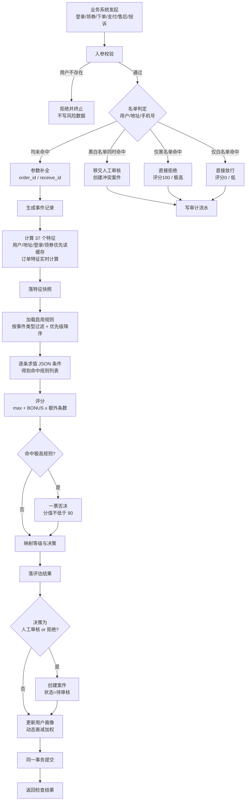
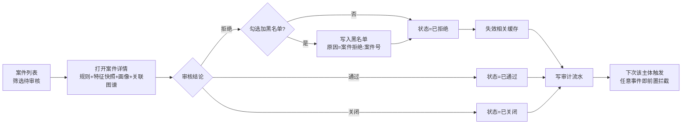
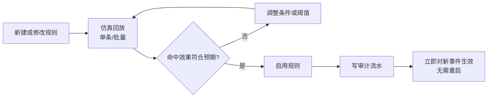
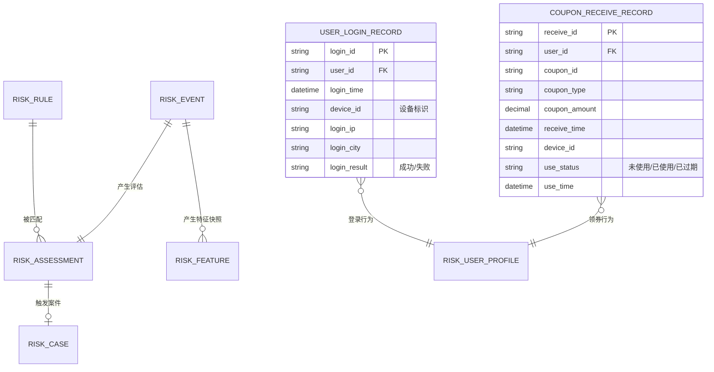
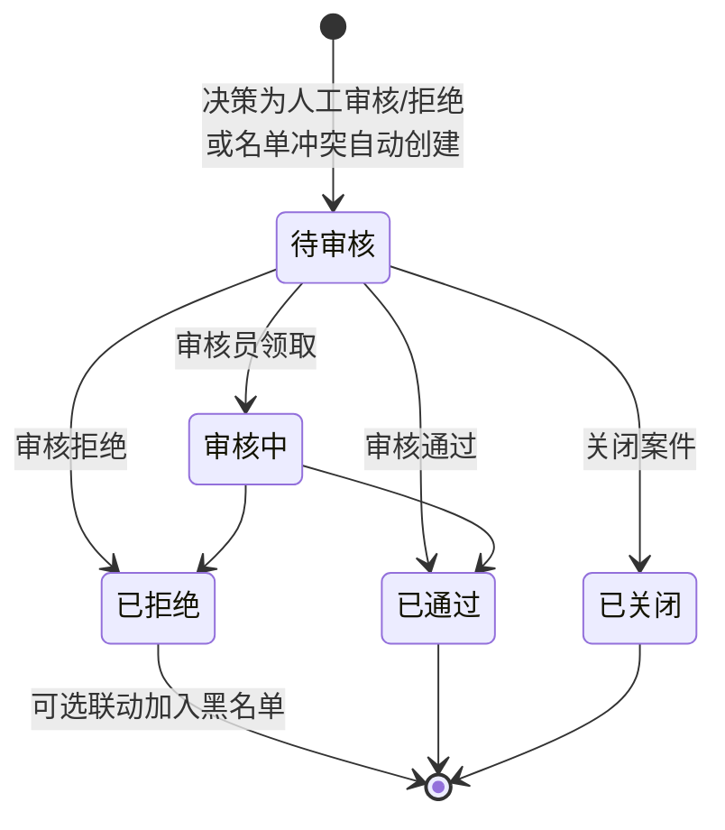

# 电商风控系统 需求规格说明书（PRD）

> | 文档名称 | 电商风控系统 需求规格说明书（PRD） |
> |----------|-----------------------------------|
> | 产品代号 | AI_Risk / risk-control-system |
> | 版本 | v1.4 |
> | 作者角色 | 产品经理 |
> | 日期 | 2026-10-13 |
> | 状态 | 评审稿 |
> | 依据 | 《大模型就业项目实战》2.3 电商风险控制系统 + AI_Risk 参考代码实现 |

---

## 修订历史

| 版本 | 日期 | 修订内容 |
|------|------|---------|
| v1.0 | 2026-10-13 | 首版。以《大模型就业项目实战》2.3 需求为基线，对照参考代码实现，补齐量化目标、页面原型、验收标准，并输出需求-实现差异分析（附录 B） |
| v1.1 | 2026-10-13 | 闭环 10 项待确认问题：补齐白名单需求与黑白名单冲突裁决；规则删除改为逻辑删除；新增操作审计流水、热点数据缓存、AI 会话持久化、黑名单归档四类需求；明确案件分类口径与画像评分口径 |
| v1.2 | 2026-10-13 | **事件类型由 4 类扩展为 6 类**：新增「登录」「营销领券」两事件，配套新增 2 张业务表、12 个特征、10 条规则（风险场景由 6 大扩为 8 大）；实体关联图谱与规则仿真回放纳入本期；新增白名单准入标准；画像衰减系数改为按用户活跃度动态取值；缓存一致性窗口确认为可接受 |
| v1.3 | 2026-10-13 | **按《需求覆盖核对表》逐条核对 2.3 全部 52 条需求，修补 9 条未覆盖项与 9 条部分覆盖项**：名单由 3 类扩至 5 类（+IP、+设备）并新增灰名单与批量导入；新增设备/IP/商品/手机号四个特征维度及地址聚集特征；新增「黄牛囤货」「聚集风险」两个规则场景；决策新增「二次验证」档；新增处置回写业务系统、资损防护统计、拦截率与风险分布图、实时事件滚屏、作弊样本库；角色命名与 2.3 对齐；确认 2 项已知取舍 |
| v1.4 | 2026-10-14 | **页面清单与原型对齐**：新增「系统配置与健康度」页面需求（FR-56，含决策阈值在线调整、缓存与降级策略、性能健康度指标、运维任务）；第 7 章新增 7.0「页面清单与路由」，页面明确为 12 个功能页并给出路由与 FR 映射；导航形态确定为**左侧分组侧边栏**；补充 7.8 审计日志页与 7.9 系统配置页原型 |

---

## 1. 产品目标与价值

### 1.1 背景与要解决的问题

电商平台在用户行为链路的多个关键节点持续承受欺诈风险：

| 风险类型 | 典型手法 | 平台损失 |
|---------|---------|---------|
| 撞库盗号 | 用泄露的账号密码批量试登，撞开后盗刷 | 用户资金损失、账号安全信任崩塌 |
| 薅羊毛 | 脚本批量注册，瞬间领空优惠券 | 营销预算被恶意消耗 |
| 刷单 | 批量账号虚假下单，制造销量假象 | 搜索排名失真，诚信商家被挤压 |
| 恶意退款 | 谎称未收到货，申请全额退款 | 商家货财两空 |
| 盗号下单 | 盗取账号大额消费 | 用户资金损失 |

传统处置依赖人工抽查，存在三个痛点：**发现晚**（事后才察觉）、**标准乱**（不同审核员判断不一致）、**不可追溯**（判了说不清依据）。

### 1.2 建设目标

构建一套**规则驱动、决策可解释、流程可闭环、审计可追溯**的电商风控系统：

1. 在**登录、营销领券、下单、支付、售后申请、物流投诉**六个关键节点实时完成「特征计算 → 规则匹配 → 评分决策」全链路，输出可解释的判定结果
2. 将风控策略从代码中解耦，业务方**零代码**即可增减规则、调整阈值
3. 建立**黑名单 + 白名单 + 灰名单**三色名单体系，覆盖**用户、手机号、IP、设备、地址**五类主体，支持精准放行、前置拦截与加严观察
4. 具备**实体关联识别能力**：通过同设备、同 IP、同地址、同手机号的聚集分析发现团伙化作案；具备**商品维度限购识别能力**，识别黄牛囤货行为
5. 中高风险事件自动沉淀为案件，支持人工复核与处置留痕；处置结论可**回写业务系统**（取消未支付订单、拒绝售后退款申请）
6. 处置结果反向回流（拒绝 → 加黑名单 → 下次前置拦截），形成闭环
7. 量化**资损防护成效**（拦截订单数与预估挽回资损），让风控价值可度量
8. 全链路操作留痕，支持事后审计与责任界定
9. 提供 AI Agent，用自然语言完成风险分析、案件查询、规则效果分析

### 1.3 成功标准（可量化）

| 编号 | 成功标准 | 目标值 | 验证方式 |
|------|---------|--------|---------|
| S-01 | 单次风控检查端到端响应时间 | < 500 ms（P95） | 接口压测，含特征 SQL + 规则匹配 + 持久化写 5 张表 |
| **S-02** | **风控特征覆盖度** | **43 个（用户 14 / 订单 8 / 地址 4 / 登录 4 / 领券 6 / 设备 2 / IP 2 / 商品 2 / 手机号 1）** | 代码清单核对 + 单元测试断言特征键集合 |
| **S-03** | **预置规则覆盖度** | **41 条，覆盖 10 大风险场景** | 初始化脚本核对 |
| **S-04** | **事件类型覆盖度** | **6 类（登录 / 营销领券 / 下单 / 支付 / 售后申请 / 物流投诉）** | 逐类发起检查，均可返回完整判定结果 |
| S-05 | 评分值域约束 | 恒落在 [0, 100] 闭区间 | 单元测试覆盖"全部规则命中"与"零规则命中"两个边界 |
| S-06 | 决策链路可追溯率 | 100% | 每次评估必须落 `rule_results`（命中规则明细）+ `risk_feature`（特征快照），抽样 20 条评估可完整复现判定过程 |
| S-07 | 规则热更新生效时延 | 0（改库即生效，无需重启） | 后台禁用某规则后立即重跑检查，该规则不再命中 |
| S-08 | 黑/白名单前置判定性能收益 | 判定路径不产生任何特征计算开销 | 名单命中后，`risk_feature` 表无新增记录（0 行） |
| S-09 | 判定的可解释性 | 每条命中规则可给出「规则名 + 分值 + 等级 + 触发动作」四要素 | 检查结果页与案件详情页逐条呈现 |
| S-10 | 关键操作审计覆盖率 | 100%（规则增删改启停、名单增删、案件审核、阈值变更） | 遍历上述操作，审计表均有记录且含操作人、时间、变更前后值 |
| S-11 | 热点数据缓存生效 | 缓存命中时不执行用户/地址特征 SQL 查询（查询次数为 0） | 同一用户连续两次检查，第二次 SQL 执行次数显著下降 |
| **S-12** | **实体关联识别能力** | **可识别同设备聚集主体（≥3 个账号）并触发规则** | 构造同设备多账号场景，检查结果命中聚集类规则 |
| **S-13** | **资损防护量化** | **大盘可展示拦截订单数与预估挽回资损金额** | 对拒绝类决策统计其关联业务单据金额，与大盘卡片数值比对一致 |
| **S-14** | **处置回写闭环** | **审核拒绝后业务单据状态同步更新** | 审核拒绝一笔未支付订单，查询业务表确认其状态已变更为取消 |

> 注：S-01 的 500ms 目标来源于现有工程文档的性能设计值，需在验收阶段实测确认。

---

## 2. 用户角色与权限矩阵

### 2.1 角色定义

| 角色 | 职责描述 | 核心权限 |
|------|---------|---------|
| **风控策略师**<br>（2.3 命名；前版称「风控管理员」） | 维护风控策略与名单库，对整体风控效果负责 | 规则的创建/编辑/启停/逻辑删除；**五类名单**的增删改查与批量导入；查看仪表盘、规则命中排行与操作审计日志；执行策略回测与仿真分析 |
| **风控审核员** | 复核系统判定的中高风险案件与名单冲突案件，做出最终处置 | 查看案件列表与统计；查看案件详情（命中规则 + 特征快照 + 用户画像 + 关联图谱 + 业务单据）；提交审核结论；拒绝时可将主体加入黑名单；对任意主体发起即时风控检查 |
| **数据分析师**<br>（超出 2.3 的角色） | 分析风控效果、研判趋势，输出策略优化建议 | 查看仪表盘与趋势；使用 AI 助手做自然语言分析；查询用户画像与业务数据 |
| **系统管理员**<br>（2.3 命名；前版称「开发运维人员」） | 维护系统运行配置，监控性能与健康度 | 访问接口文档与健康状态；查看运行日志；调整阈值配置；监控事件吞吐性能与接口调用健康度；执行名单归档任务；查看操作审计日志 |
| **审计人员**<br>（超出 2.3 的角色） | 独立核查风控操作的合规性 | 只读查看操作审计流水、案件处置记录、规则变更历史 |

### 2.2 权限矩阵

| 功能模块 | 风控策略师 | 风控审核员 | 数据分析师 | 系统管理员 | 审计人员 |
|---------|:---------:|:---------:|:---------:|:-------:|:-------:|
| 仪表盘查看 | ✓ | ✓ | ✓ | ✓ | ✓ |
| 规则管理（增删改启停） | ✓ | — | — | — | 只读 |
| 规则仿真回放 | ✓ | ✓ | ✓ | — | — |
| 案件列表 / 详情 | ✓ | ✓ | 只读 | — | 只读 |
| 案件审核处置 | — | ✓ | — | — | — |
| 名单管理（黑/白/灰，5 类主体） | ✓ | 仅拒绝时新增黑名单 | — | — | 只读 |
| 名单批量导入 | ✓ | — | — | — | — |
| 用户画像查询 | ✓ | ✓ | ✓ | — | ✓ |
| 关联图谱查看 | ✓ | ✓ | ✓ | — | 只读 |
| 风险检查（即时） | ✓ | ✓ | ✓ | — | — |
| AI 助手 | ✓ | ✓ | ✓ | — | — |
| 操作审计日志 | ✓ | — | — | ✓ | ✓ |
| 系统配置 / 阈值调整 | — | — | — | ✓ | 只读 |
| 性能与健康度监控 | — | — | — | ✓ | — |

> **本期不实现登录鉴权（RBAC）**，角色用于界定功能归属与操作规范，不做系统级权限拦截。审计表需预留「操作人」字段，待鉴权落地后自动生效。

---

## 3. 用户故事

### 3.1 风控策略师

- **US-01**：作为风控策略师，我希望在没有新欺诈模式时能**零代码新增一条规则**（填 JSON 条件、分值和动作），以便快速响应黑产变形。
- **US-02**：作为风控策略师，我希望在某条规则误判率过高时**一键禁用**它，以便立即止损而不影响其他规则。
- **US-03**：作为风控策略师，我希望能把恶意主体加入黑名单并**设置有效期**，以便在特定时间段内阻止其交易、到期自动失效。
- **US-04**：作为风控策略师，我希望在仪表盘看到**今日评估量、高风险数、命中规则 TOP5**，以便及时察觉异常趋势。
- **US-05**：作为风控策略师，我希望能把**优质大客户、官方账号加入白名单**，以便他们不被规则误伤。
- **US-06**：作为风控策略师，我希望删除规则时**保留历史记录**（逻辑删除），以便历史评估仍能追溯到当时的规则内容。
- **US-07**：作为风控策略师，我希望在**规则上线前用仿真回放验证命中效果**，以便避免规则误伤或空转。

### 3.2 风控审核员

- **US-08**：作为风控审核员，我希望案件列表能**按状态和分类筛选并分页**，以便优先处理高风险案件。
- **US-09**：作为风控审核员，我希望打开案件时能**同时看到命中规则、当时的特征快照、用户画像和关联主体**，以便做出有依据的判断。
- **US-10**：作为风控审核员，我希望在拒绝案件时能**勾选同时加入黑名单**，以便自动阻断该主体后续交易。
- **US-11**：作为风控审核员，我希望对可疑主体**立即执行一次风控检查**，以便掌握其当前风险状况。
- **US-12**：作为风控审核员，我希望从案件能**一键跳回风控检查并自动回填原始业务参数**（重做检查），以便验证规则调整后的效果。
- **US-13**：作为风控审核员，我希望当一个主体**同时命中黑白名单**时，系统移交人工审核而不是自动放行或拦截，以便处理冲突、避免误判。

### 3.3 数据分析师

- **US-14**：作为数据分析师，我希望通过 AI 助手用**自然语言查询最近 30 天的风险趋势**，以便撰写分析报告，而不必手写 SQL。
- **US-15**：作为数据分析师，我希望 AI 助手能**分析各规则的命中次数与效果**，以便识别失效或过度触发的规则。
- **US-16**：作为数据分析师，我希望查询指定用户的**订单、售后、地址、登录、领券历史**，以便做深入个案分析。

### 3.4 开发运维人员 / 审计人员

- **US-17**：作为开发人员，我希望通过**接口文档页面**查看并调试全部接口，以便高效完成前后端联调。
- **US-18**：作为运维人员，我希望通过**环境变量**调整风控阈值、多规则加分值与画像衰减系数，以便按业务节奏调整策略。
- **US-19**：作为运维人员，我希望数据库连接**断开后能自动恢复**，以便在 MySQL 重启等场景下无需重启应用。
- **US-20**：作为运维人员，我希望**缓存服务不可用时系统自动降级为直查数据库**，以便缓存故障不影响风控主链路。
- **US-21**：作为审计人员，我希望查看**全量操作审计流水**（谁、在何时、对什么、做了什么变更），以便核查合规性与界定责任。

### 3.5 新增能力相关（v1.3，对应核对表修补项）

- **US-22**：作为风控策略师，我希望把**设备与 IP 也纳入名单**（除用户、手机号、地址外），以便封禁批量作案的设备与出口 IP。
- **US-23**：作为风控策略师，我希望**批量导入名单**，以便一次性处理大量历史黑产主体。
- **US-24**：作为风控策略师，我希望把**可疑但未确认**的主体放入灰名单，以便对其加严判定而不是直接误伤。
- **US-25**：作为风控审核员，我希望审核拒绝后系统**自动回写业务系统**（取消未支付订单、拒绝售后退款申请），以便处置动作真正落到业务上。
- **US-26**：作为风控策略师，我希望看到**拦截订单数与预估挽回资损**，以便向管理层量化和汇报风控价值。
- **US-27**：作为风控策略师，我希望针对**限购类商品识别黄牛囤货**，以便保护真实消费者的购买机会。
- **US-28**：作为系统管理员，我希望在一个页面里**在线调整决策阈值与引擎参数，并查看缓存命中率、P95 响应时间、单次检查耗时分解等健康度指标**，以便按业务节奏调参，且能立刻确认调参没有拖垮性能。

> 用户故事共 28 条，均可映射到第 4 章的功能需求编号。

---

## 4. 功能需求清单

### 4.1 需求池总表

优先级：**P0 必须 / P1 重要 / P2 可选**。
实现状态：**已具备**（参考代码已实现）/ **待实现**（本期需补齐）。

| 编号 | 模块 | 功能 | 优先级 | 状态 | 关联 US |
|------|------|------|--------|------|---------|
| FR-01 | 风控检查 | 实时风险检查（入口管道，支持 6 类事件） | P0 | 已具备（需扩事件） | US-11 |
| FR-02 | 风控检查 | 特征计算（37 个） | P0 | 已具备（需扩特征） | — |
| FR-03 | 风控检查 | JSON 条件规则匹配 | P0 | 已具备 | — |
| FR-04 | 风控检查 | 评分与决策映射 | P0 | 已具备 | — |
| FR-05 | 名单体系 | 黑名单前置拦截 | P0 | 已具备 | US-03 |
| FR-06 | 名单体系 | 白名单前置放行 + **灰名单加严判定** | P0 | 待实现 | US-05、US-24 |
| FR-38 | 名单体系 | 名单冲突裁决（同时命中移交人审） | P0 | 待实现 | US-13 |
| **FR-54** | **名单体系** | **名单主体扩展至 5 类（用户 / 手机号 / IP / 设备 / 地址）** | **P0** | **待实现** | US-22 |
| **FR-45** | **风控检查** | **登录事件风控接入** | **P0** | **待实现** | US-11 |
| **FR-46** | **风控检查** | **营销领券事件风控接入** | **P0** | **待实现** | US-11 |
| **FR-07** | **关联分析** | **实体关联图谱（同设备 / IP / 地址 / 手机号聚集识别）** | **P1** | **本期实现** | US-09 |
| FR-08 | 规则管理 | 规则列表查询（按分类筛选、优先级排序） | P0 | 已具备 | US-01 |
| FR-09 | 规则管理 | 规则创建 | P0 | 已具备 | US-01 |
| FR-10 | 规则管理 | 规则编辑（部分更新） | P0 | 已具备 | US-01 |
| FR-11 | 规则管理 | 规则启用/禁用 | P0 | 已具备 | US-02 |
| FR-12 | 规则管理 | 规则删除（逻辑删除） | P1 | 待实现（改造） | US-06 |
| FR-13 | 规则管理 | 规则条件格式校验 | P0 | 已具备 | US-01 |
| **FR-14** | **规则管理** | **规则仿真回放（单步展示命中链路）** | **P1** | **本期实现** | US-07 |
| FR-15 | 案件管理 | 案件列表查询（状态/分类筛选 + 分页） | P0 | 已具备 | US-08 |
| FR-16 | 案件管理 | 案件详情（案件 + 评估 + 命中规则 + 画像 + 关联主体） | P0 | 已具备（需扩图谱） | US-09 |
| FR-17 | 案件管理 | 案件审核处置 | P0 | 已具备 | US-10 |
| FR-18 | 案件管理 | 审核拒绝时联动加黑名单 | P0 | 已具备 | US-10 |
| FR-19 | 案件管理 | 案件统计 | P1 | 已具备 | US-08 |
| FR-20 | 案件管理 | 重做检查（案件 → 检查页参数回填） | P1 | 已具备 | US-12 |
| FR-21 | 名单管理 | 名单列表查询（按颜色与主体类型筛选） | P0 | 已具备（需扩展） | US-03 |
| FR-22 | 名单管理 | 新增名单项（三色 × 五类主体 + 可设有效期） | P0 | 已具备（需扩展） | US-03、US-22 |
| FR-23 | 名单管理 | 移除名单项 | P0 | 已具备 | US-03 |
| FR-24 | 名单管理 | 过期自动失效 | P0 | 已具备 | US-03 |
| FR-42 | 黑名单 | 过期记录定时归档 | P2 | 待实现 | — |
| FR-25 | 用户画像 | 画像查询 | P1 | 已具备 | US-16 |
| FR-43 | 用户画像 | 画像评分时间衰减加权（α 动态取值） | P1 | 待实现（改造） | — |
| FR-26 | 仪表盘 | 今日风控概览（评估数/高风险数/待审数/通过率） | P1 | 已具备 | US-04 |
| FR-27 | 仪表盘 | 近 7 天趋势 | P1 | 已具备 | US-04、US-14 |
| FR-28 | 仪表盘 | 规则命中 TOP5 | P1 | 已具备 | US-04、US-15 |
| FR-29 | AI Agent | 多轮对话（会话上下文保持） | P1 | 已具备 | US-14 |
| FR-30 | AI Agent | 风控决策类工具（4 个） | P1 | 已具备 | US-14~16 |
| FR-31 | AI Agent | 数据分析类工具（4 个） | P1 | 已具备 | US-14~16 |
| FR-32 | AI Agent | 会话清除 | P2 | 已具备 | — |
| FR-41 | AI Agent | 会话持久化存储 | P1 | 待实现（改造） | US-14 |
| FR-33 | 前端页面 | 仪表盘页 | P0 | 已具备 | US-04 |
| FR-34 | 前端页面 | 规则管理页 | P0 | 已具备 | US-01 |
| FR-35 | 前端页面 | 案件管理页 | P0 | 已具备 | US-08 |
| FR-36 | 前端页面 | 风险检查页（事件类型扩至 6 类） | P0 | 已具备（需扩） | US-11 |
| FR-37 | 前端页面 | AI 助手页 | P1 | 已具备 | US-14 |
| FR-44 | 前端页面 | 名单管理页（三色名单统一维护 + 批量导入） | P1 | 待实现 | US-05、US-23 |
| **FR-47** | **前端页面** | **关联图谱可视化页（设备/IP 聚集网络）** | **P1** | **待实现** | US-09 |
| FR-39 | 审计 | 操作审计流水（全量关键操作留痕） | P1 | 待实现 | US-21 |
| FR-40 | 性能 | 热点数据缓存（特征 + 画像 + 图谱） | P1 | 待实现 | US-20 |
| **FR-48** | **案件管理** | **处置回写业务系统（取消未支付订单 / 拒绝售后退款申请）** | **P1** | **待实现** | US-25 |
| **FR-49** | **名单管理** | **名单批量导入（Excel / CSV）** | **P2** | **待实现** | US-23 |
| **FR-50** | **仪表盘** | **资损防护统计（拦截订单数 + 预估挽回资损）** | **P1** | **待实现** | US-26 |
| **FR-51** | **仪表盘** | **实时事件流（滚屏）** | **P2** | **待实现** | US-04 |
| **FR-52** | **规则管理** | **作弊样本库与批量回放** | **P2** | **待实现** | US-07 |
| **FR-53** | **风控检查** | **商品维度囤货识别（限购类）** | **P1** | **待实现** | US-27 |
| **FR-55** | **前端页面** | **规则条件可视化构建器（降级方案，见 10.4）** | **P2** | **待实现** | US-01 |
| **FR-56** | **前端页面** | **系统配置与健康度页（阈值在线调整 · 缓存与降级策略 · 性能健康度 · 运维任务）** | **P1** | **待实现** | US-28 |

**统计**：共 55 条功能需求。P0 共 21 条（覆盖主流程 100%），P1 共 22 条，P2 共 7 条（含 3 条降级/可选实现）。
**v1.3 变化**：新增 FR-48 ~ FR-55；FR-01、FR-02、FR-16、FR-21、FR-22、FR-36、FR-44 扩充范围；FR-06 增加灰名单语义。
**v1.4 变化**：新增 FR-56（系统配置与健康度页）；第 7 章新增 7.0 页面清单与 7.8 / 7.9 原型。

### 4.2 核心算法需求

#### FR-04 评分与决策映射

**评分公式**：

```
final_score = min( max(命中规则各自分值) + BONUS × (命中规则数 - 1) , 100 )
其中 BONUS = 3（可配置）
```

**一票否决**：若任一命中规则的等级为「极高」，则 `final_score = max(final_score, 90)`

**设计意图**：以最高风险项为基准分，多命中一条加 3 分，体现「多维度异常 = 更危险」的风控直觉。

**决策映射表**：

| 评分区间 | 风险等级 | 决策 | 后续动作 |
|---------|---------|------|---------|
| 0 ~ 29 | 低 | 通过（Pass） | 放行交易 |
| 30 ~ 59 | 中 | 标记 | 记录但放行 |
| 60 ~ 79 | 高 | 人工审核（Review）**或 二次验证（Challenge）** | 人工审核 → 自动创建案件；二次验证 → 生成待验证记录并阻断当前操作，等待用户完成验证 |
| 80 ~ 100 | 极高 | 拒绝（Reject） | 自动创建案件并阻止交易 |

> **二次验证（Challenge）说明**：对应 2.3 决策模型中的 Challenge 档。当命中规则的动作为「二次验证」时，最终决策输出 `二次验证`，系统生成待验证记录并阻断当前操作。**模拟实现**：不接真实短信/验证码通道，仅落库并返回验证凭据占位；验证通过则放行，超时未验证则升级为人工审核。
> 三个分界点（30 / 60 / 80）、多规则加分值（3）、一票否决最低分（90）、二次验证超时时间均为可配置项。

**验收标准**：
1. 零规则命中时 `final_score = 0`，决策为「通过」
2. 仅一条规则命中时 `final_score = 该规则分值`（不叠加加分）
3. 命中 N 条规则时加分恰为 `3 × (N-1)`
4. 加分后超过 100 时截断为 100
5. 任一规则等级为「极高」时，最终分不低于 90

#### FR-03 规则条件求值

**条件表达式结构**（JSON）：

```json
{"field": "addr_is_new", "op": "==", "value": 1}
```

```json
{"and": [
  {"field": "addr_is_new", "op": "==", "value": 1},
  {"field": "order_total_amount", "op": ">=", "value": 2000}
]}
```

**支持的运算符（9 个比较符 + 2 个逻辑符）**：

| 类型 | 运算符 | 说明 |
|------|--------|------|
| 比较 | `>` `>=` `<` `<=` `==` `!=` | 数值比较，value 强制转数值 |
| 集合 | `in` `not_in` | value 为列表 |
| 区间 | `between` | value 为 `[min, max]`，闭区间 |
| 逻辑 | `and` `or` | 可嵌套组合子条件 |

**处理规则**：
1. 特征不存在于特征字典时，该条件**判定为不命中**（不报错）
2. 遇到不支持的运算符时，记录警告日志并**判定为不命中**（不抛异常、不中断流程）
3. 条件求值发生异常时，捕获并**判定为不命中**，同时记录警告

**验收标准**：
1. `and` 需全部子条件成立才命中；`or` 需至少一个成立
2. 逻辑符可嵌套（如 `and` 内嵌 `or`）
3. 未知运算符不导致接口 500，仅返回不命中
4. 引用不存在的特征名时返回不命中，不抛异常

#### FR-05 / FR-06 / FR-38 名单体系与冲突裁决

**名单类型（三色）**：

| 类型 | 语义 | 命中后的动作 |
|------|------|-------------|
| 黑名单 | 已确认的恶意主体 | 直接拒绝（评分 100 / 等级极高），不做特征计算与规则匹配 |
| 白名单 | 已确认的可信主体（战略客户、官方账号、误判澄清用户） | 直接放行（评分 0 / 等级低），不做特征计算与规则匹配 |
| **灰名单** | **可疑但尚未确认的主体（观察期主体）** | **不直接拦截也不放行；对最终评分施加加严系数（默认 +15 分，可配置），仍走正常判定流程** |

**名单主体（五类）**：用户 / 手机号 / IP / 设备 / 地址 —— 三色名单共用同一套主体维度定义

**判定顺序与冲突裁决（核心规则）**：

```
第 1 步：以「用户 / 手机号 / IP / 设备 / 地址」五类主体分别查询黑、白、灰名单
第 2 步：按以下优先级裁决
        ① 黑名单与白名单「同时命中」 → 决策 = 人工审核（评分按正常流程计算，并创建案件）
                                      理由：冲突场景不做自动裁决，交人工处理
        ② 仅黑名单命中              → 决策 = 拒绝，评分 = 100，等级 = 极高
        ③ 仅白名单命中              → 决策 = 通过，评分 = 0，等级 = 低
        ④ 仅灰名单命中              → 进入正常流程，最终评分 = min(正常评分 + 灰名单加严系数, 100)
        ⑤ 三者均未命中              → 进入正常的风控检查流程
第 3 步：过期记录不参与判定（有效期为空 = 永久有效）
第 4 步：优先级说明 —— 白名单 > 黑色冲突判定 > 灰名单
```

**五类主体的查询来源**：

| 主体 | 来源 |
|------|------|
| 用户 | 风控请求的 user_id |
| 手机号 / 地址 | 该用户关联的收货信息 |
| IP / 设备 | 本次事件上下文自带；下单/支付等事件若无设备信息，取该用户最近一次登录记录 |

**冲突裁决的额外要求**：
1. 移交人工审核时，案件的风险详情中必须**明确标注冲突原因**（命中哪条白名单、命中哪条黑名单）
2. 冲突案件在案件列表中应有**可识别的标记**，便于审核员优先处理

**验收标准**：
1. 黑名单主体发起请求时立即返回拒绝（评分 100 / 等级极高）
2. 白名单主体发起请求时立即返回通过（评分 0 / 等级低）
3. 同一主体同时命中黑白名单时，决策为「人工审核」且自动创建案件，案件详情含冲突说明
4. 已过期记录不触发任何拦截或放行
5. 名单判定路径不产生特征快照记录（0 条 `risk_feature`）
6. 白名单命中日志可查（用于核对白名单是否被滥用）

#### FR-45 登录事件风控接入

**业务背景**：撞库盗号是电商账号安全的首要威胁。攻击者用泄露的账号密码批量试登，撞开后立即盗刷。该行为在**登录环节**即有明显信号，不必等到下单才拦截。

**需要的数据支撑**（需求视角）：
系统需具备**登录记录**能力，记录每次登录的：账号、登录时间、设备标识、IP 地址、登录结果（成功/失败）、登录所在地。

**核心判定信号**：

| 信号 | 说明 | 对应特征 |
|------|------|---------|
| 短时高频失败 | 短时间内大量登录失败，典型撞库特征 | login_fail_count_1h |
| 短时高频登录 | 机器脚本的登录频率远高于人工 | login_count_1h |
| 同设备多账号 | 一台设备短时间登录多个账号，团伙或养号特征 | login_device_account_count_24h |
| 同 IP 多账号 | 一个 IP 批量登录多个账号，代理池特征 | login_ip_account_count_24h |
| 新设备 + 异地 | 首次使用的设备且短期内出现多个登录城市 | login_is_new_device、login_city_count_7d |

**验收标准**：
1. 「登录」作为独立事件类型，可发起风控检查并返回完整判定结果
2. 登录事件下仅加载「登录安全」与「通用」类规则，不加载下单/售后类规则
3. 命中聚集类规则（同设备/同 IP 多账号）时，案件详情可展示关联主体

#### FR-46 营销领券事件风控接入

**业务背景**：营销预算是风控保护的重要资产。黑产用脚本批量注册账号，瞬间领空优惠券再转卖或弃用，导致营销投入打水漂。该行为在**领券环节**即可识别。

**需要的数据支撑**（需求视角）：
系统需具备**领券记录**能力，记录每次领券的：账号、券标识、券种、券面金额、领取时间、设备标识、使用状态、使用时间。

**核心判定信号**：

| 信号 | 说明 | 对应特征 |
|------|------|---------|
| 短时批量领券 | 人工不可能在 1 小时内领 10 张券 | coupon_count_1h |
| 同设备多账号领券 | 脚本批量注册的核心特征 | coupon_device_account_count_24h |
| 全券种扫荡 | 把平台所有可领券种领一遍，非真实消费意图 | coupon_type_count_24h |
| 大额累计领券 | 24 小时内累计券面金额异常 | coupon_amount_24h |
| 领而不用 | 历史用券率极低，说明领券目的是套利而非消费 | coupon_use_rate |

**验收标准**：
1. 「营销领券」作为独立事件类型，可发起风控检查并返回完整判定结果
2. 领券事件下仅加载「营销薅羊毛」与「通用」类规则
3. 命中同设备聚集类规则时，案件详情可展示关联主体

#### FR-01 风控检查入口管道

**输入**：事件类型、业务来源 ID、用户 ID、订单 ID（可选）、收货信息 ID（可选）

**处理顺序**：
1. 入参兜底校验（用户必须存在，否则直接拒绝、不写任何风险数据）
2. **名单前置判定**（黑名单 / 白名单 / 冲突裁决，见 FR-05、FR-06、FR-38）
3. 参数补全：事件为「下单/支付」且未传订单 ID 时，以业务来源 ID 作为订单 ID；未传收货信息 ID 时，从订单反查
4. 生成事件记录（事件 ID、评估 ID）
5. 计算 37 个特征并落特征快照（用户/地址/登录/领券特征优先读缓存，订单特征实时计算，见 FR-40）
6. 加载该事件类型（含「通用」）下启用的规则，按优先级降序匹配
7. 计算评分、判定等级与决策
8. 持久化评估结果
9. 决策为「人工审核/拒绝」时创建案件
10. 更新用户画像
11. 写入操作审计（若触发名单/规则变更类操作）

**验收标准**：
1. 支持 **6 类事件**：登录、营销领券、下单、支付、售后申请、物流投诉
2. 返回结果包含评估 ID、评分、风险等级、决策、命中规则列表、特征字典
3. 单次检查产生的全部落库操作**在同一事务内提交**，任一步失败则整体回滚
4. 「人工审核」与「拒绝」两种决策均自动创建案件，案件状态初始为「待审核」

#### FR-07 实体关联图谱

**业务背景**：单个账号的行为可能看起来正常，但**同一设备或同一 IP 下聚集多个账号**，往往是团伙化作案的铁证。这是「单点判定」升级为「群体判定」的关键能力。

**关联维度**：

| 关联键 | 说明 | 典型场景 |
|--------|------|---------|
| 设备标识 | 同一设备登录/领券/下单的多个账号 | 脚本批量养号 |
| IP 地址 | 同一 IP 登录/领券的多个账号 | 代理池批量操作 |
| 收货地址 | 同一收货地址关联的多个账号 | 恶意退款团伙 |
| 手机号 | 同一手机号关联的多个账号 | 小号矩阵 |

**能力要求**：
1. 给定一个主体（用户/设备/IP/地址），可**反向查出与之关联的其他主体**，形成关联网络
2. 关联结果以**图谱形式**可视化呈现（节点 = 主体，边 = 关联关系）
3. 关联规模达到阈值时（如同一设备关联 ≥3 个账号），可作为**特征参与规则判定**，也可在案件详情中作为证据展示
4. 图谱查询需支持**跳数限制**（默认 2 跳），避免在大数据量下无限扩散

**验收标准**：
1. 对给定用户，可查出其关联的设备、IP、地址及通过这些键关联到的其他账号
2. 关联结果在案件详情中以图谱形式展示，支持点选节点查看该主体信息
3. 存在同设备关联 ≥3 个账号的场景时，对应规则可命中
4. 图谱查询有跳数上限，超出上限不继续扩散

#### FR-12 规则删除（逻辑删除）

**需求变更**：由物理删除改为**逻辑删除**。

- 删除操作将规则标记为「已删除」，不物理移除记录
- 已删除的规则**不参与**规则匹配
- 历史评估结果中引用的规则仍可通过 `rule_id` 追溯到规则名称与内容
- 规则列表默认不展示已删除规则，可提供「查看已删除」筛选

**验收标准**：
1. 删除规则后，该规则不再出现在默认列表与规则匹配中
2. 删除规则后，历史评估详情仍能正确显示该规则名称（可追溯）
3. 重复删除同一规则不产生副作用

#### FR-14 规则仿真回放

**业务背景**：规则上线前需要验证「会命中谁、误伤多少人」。直接在生产上试错代价高。

**能力要求**：
1. 支持对**单条事件**执行仿真，**分步展示**：特征提取结果 → 逐条规则的求值过程（命中/未命中）→ 最终评分 → 决策输出
2. 支持对**一组历史事件**批量回放，统计某条规则的命中数、命中率与影响的用户数
3. 仿真**不产生任何副作用**：不写事件记录、不写特征快照、不创建案件、不更新画像
4. 支持「改前 vs 改后」对比：用同一批事件分别跑新旧规则配置，输出差异

**验收标准**：
1. 单条仿真可逐步展示特征与每条规则的求值结果
2. 仿真操作后，`risk_event` / `risk_feature` / `risk_case` 表均无新增记录
3. 批量回放可输出规则的命中数与命中率统计

#### FR-43 用户画像评分口径（时间衰减加权 + 动态系数）

**需求变更**：画像评分由「最近一次评估结果直接覆盖」改为**时间衰减加权**，且衰减系数按用户活跃度动态取值。

**计算公式**：

```
new_score = round( α × 本次评分 + (1 - α) × 历史评分 )
```

**动态系数 α（按用户活跃度分档，各档值可配置）**：

| 用户活跃度 | 判定条件 | α 取值 | 设计理由 |
|-----------|---------|--------|---------|
| 高活跃 | 近 30 天订单数 ≥ 5 | **0.7** | 行为样本充分且稳定，单次异常更值得重视，画像跟随快 |
| 中活跃 | 1 ≤ 近 30 天订单数 < 5 | **0.6** | 默认档 |
| 低活跃 / 新用户 | 近 30 天订单数 = 0 | **0.4** | 历史样本少，单次高分不足以定性，画像更保守 |

**设计意图**：避免「一次偶发高分把用户打成永久高危」，同时对行为稳定的老用户保持足够的灵敏度。

**验收标准**：
1. 首次评估时，画像评分 = 本次评分（无历史值）
2. 后续评估按衰减公式计算，结果仍落在 [0, 100]
3. 相同评分序列下，高活跃用户的画像变化幅度大于低活跃用户
4. 连续多次高分评估后，画像评分单调趋近高分（而非停留在首次值）

#### FR-48 处置回写业务系统（v1.3 新增）

**业务背景**：2.3 要求「审核人员完成案件处置后，系统联动更新业务订单状态」。若处置结论只停留在风控库、不回写业务系统，则「拒绝」只是一条记录，订单仍会继续流转，风控形同虚设。

**回写规则**：

| 处置结论 | 事件类型 | 回写动作 |
|---------|---------|---------|
| 拒绝 | 下单 | 订单未支付 → 取消订单；已支付 → 标记为待退款并生成拦截记录 |
| 拒绝 | 支付 | 标记订单为风控拦截，阻止后续发货流程 |
| 拒绝 | 售后申请 | 售后单状态置为「已驳回」 |
| 拒绝 | 登录 | 强制该账号下线并要求重新验证 |
| 拒绝 | 营销领券 | 作废已领取但未使用的券 |
| 通过 | 任意 | 无回写动作（仅记录结论） |

**约束**：
1. 回写与案件状态更新必须在**同一事务**内完成
2. 回写失败时案件状态回滚，并记录失败原因供人工重试
3. 所有回写动作记入操作审计流水

**验收标准**：
1. 审核拒绝一笔未支付订单后，业务订单表中该订单状态变为已取消
2. 审核拒绝一笔售后申请后，售后单状态变为已驳回
3. 回写失败时案件状态不推进，且可在案件详情看到失败原因
4. 回写动作在审计流水中可查

#### FR-53 商品维度囤货识别（v1.3 新增）

**业务背景**：2.3 项目目标明确列出「黄牛恶意囤货」。黄牛针对限购或高价值商品，用单账号超量购买或**拆单**（分成多笔小单）方式绕过限购，再高价转卖。

**识别信号**：

| 信号 | 说明 | 对应特征 |
|------|------|---------|
| 单 SKU 超量 | 短时间大量购买同一 SKU | sku_buy_count_24h |
| 拆单规避 | 同一 SKU 多笔订单凑量，规避单笔限购 | sku_order_count_24h |
| 高价值囤积 | 高客单 + 多件同一商品 | order_total_amount + sku_buy_count_24h |

**验收标准**：
1. 构造单账号 24 小时内购买同一 SKU 共 12 件的场景，检查可命中 B001
2. 构造同一 SKU 分 5 笔订单共买 10 件的场景，检查可命中 B002
3. 商品维度特征在非下单事件下取值为 0，不干扰其他事件判定

### 4.3 预置特征清单（43 个）

**统一契约**：全部特征返回 `dict[str, float]`，规则引擎通过特征名字符串消费，特征与规则互不侵入。

**用户维度（14 个）**

| 特征名 | 含义 | 数据来源 |
|--------|------|---------|
| user_total_orders | 历史订单总数 | 订单表 |
| user_orders_30d | 近 30 天订单数 | 订单表 |
| user_orders_7d | 近 7 天订单数 | 订单表 |
| user_total_amount | 历史总消费金额 | 订单明细 + 订单表 |
| user_avg_order_amount | 平均订单金额（派生） | total_amount / total_orders |
| user_max_order_amount | 最大单笔金额 | 订单明细 + 订单表 |
| user_refund_count | 退款总次数 | 售后 + 订单明细 + 订单表 |
| user_postsale_count | 售后总次数 | 售后 + 订单明细 + 订单表 |
| user_refund_rate | 退款率（派生，保留 4 位） | refund_count / total_orders |
| user_postsale_rate | 售后率（派生，保留 4 位） | postsale_count / total_orders |
| user_refund_amount | 退款总金额 | 售后 + 订单明细 + 订单表 |
| user_cancel_count | 取消订单次数 | 订单表 |
| user_complaint_count | 投诉次数 | 物流投诉记录表 |
| user_address_count | 收货地址数量 | 收货信息表 |

**订单维度（8 个）**

| 特征名 | 含义 | 数据来源 |
|--------|------|---------|
| order_total_amount | 订单总金额 | 订单明细 |
| order_item_count | 订单明细行数 | 订单明细 |
| order_sku_count | 商品总数量 | 订单明细 |
| order_discount_amount | 折扣总金额 | 订单明细 |
| order_discount_rate | 折扣率（派生） | 折扣额 / 原价 |
| order_pay_interval_sec | 下单到支付时间差（秒） | 订单表 |
| order_is_night | 是否夜间下单（0-6 点，1/0） | 订单表 |
| order_category_count | 商品类别数 | 订单明细 + 商品表 |

**地址维度（4 个）**

| 特征名 | 含义 | 数据来源 |
|--------|------|---------|
| addr_total_count | 用户地址总数 | 收货信息表 |
| addr_province_count | 不同省份数 | 收货信息表 |
| addr_is_new | 当前地址是否首次使用（1/0） | 订单表 + 收货信息表 |
| **addr_account_count** | **当前收货地址关联的不同账号数（聚集度）** | 收货信息表 + 订单表 |

**登录维度（4 个）**

| 特征名 | 含义 | 数据来源 |
|--------|------|---------|
| login_count_1h | 近 1 小时登录次数 | 登录记录表 |
| login_fail_count_1h | 近 1 小时登录失败次数 | 登录记录表 |
| login_city_count_7d | 近 7 天登录涉及的城市数 | 登录记录表 |
| login_is_new_device | 当前设备是否首次用于登录（1/0） | 登录记录表 |

> 原「同设备登录账号数」「同 IP 登录账号数」两个特征已提升为**设备维度**与 **IP 维度**的通用特征（见下），因为聚集识别是跨事件的通用能力，不应只局限于登录场景。

**营销领券维度（6 个，新增）**

| 特征名 | 含义 | 数据来源 |
|--------|------|---------|
| coupon_count_1h | 近 1 小时领券次数 | 领券记录表 |
| coupon_count_24h | 近 24 小时领券次数 | 领券记录表 |
| coupon_amount_24h | 近 24 小时领取券面总额 | 领券记录表 |
| coupon_device_account_count_24h | 近 24 小时同设备领券的**不同账号数** | 领券记录表（跨账号聚合） |
| coupon_type_count_24h | 近 24 小时领取的**不同券种数** | 领券记录表 |
| coupon_use_rate | 历史用券率（已使用 / 已领取） | 领券记录表 |

**设备维度（2 个，v1.3 新增）**

| 特征名 | 含义 | 数据来源 |
|--------|------|---------|
| device_account_count_24h | 近 24 小时同设备活跃的**不同账号数** | 登录记录表（跨账号聚合） |
| device_order_count_1h | 近 1 小时同设备的下单次数 | 订单表 + 登录记录表 |

**IP 维度（2 个，v1.3 新增）**

| 特征名 | 含义 | 数据来源 |
|--------|------|---------|
| ip_account_count_24h | 近 24 小时同 IP 活跃的**不同账号数** | 登录记录表（跨账号聚合） |
| ip_register_account_count | 同 IP 注册的账号数 | 登录记录表（跨账号聚合） |

**商品维度（2 个，v1.3 新增）**

| 特征名 | 含义 | 数据来源 |
|--------|------|---------|
| sku_buy_count_24h | 当前用户近 24 小时购买该 SKU 的总数量 | 订单明细 + 订单表 |
| sku_order_count_24h | 当前用户近 24 小时购买该 SKU 的订单数 | 订单明细 + 订单表 |

**手机号维度（1 个，v1.3 新增）**

| 特征名 | 含义 | 数据来源 |
|--------|------|---------|
| phone_refund_rate_24h | 近 24 小时同收货手机号的退款率 | 售后 + 订单 + 收货信息表（跨账号聚合） |

**边界值约定**：
- 订单不存在或未支付时，订单维度特征取 0
- `order_pay_interval_sec` 在订单**未支付**时取 **-1**，作为「未支付」的哨兵值，用于与「支付间隔为 0 秒」区分。**依赖该特征的规则必须显式判断 `>= 0` 或使用 `not_in [-1]`，不得直接将 -1 参与大小比较。**
- 分母为 0 的派生特征（如退款率、用券率）取 0，不做除零
- 无登录/领券记录时，对应维度特征取 0；`login_is_new_device` 首次登录取 1
- **跨账号聚合特征**（同设备/同 IP 的不同账号数）为统计值，本身不泄露其他账号身份，仅在案件详情的关联图谱中按权限展开

### 4.4 预置规则清单（41 条 / 10 大场景）

| 场景 | 风险行为 | 规则数 | 规则 ID 区间 | 适用事件 |
|------|---------|-------|-------------|---------|
| ① 订单欺诈 | 大额订单、深夜下单、极速支付、极端高额 | 5 | R001 ~ R005 | 下单 |
| ② 支付风险 | 高频下单、海量下单、金额异常、累计消费异常 | 4 | R006 ~ R009 | 支付 |
| ③ 账户风险 | 高取消率、新用户大额、多投诉、多地址 | 4 | R010 ~ R013 | 通用 |
| ④ 售后滥用 | 高退款率、极端退款率、高售后率、高退款金额 | 4 | R014 ~ R017 | 售后申请 |
| ⑤ 地址风险 | 新地址、新地址大额、多省份、多地址高金额 | 4 | R018 ~ R021 | 下单 |
| ⑥ 物流风险 | 投诉用户下单、高频投诉、多品类订单 | 3 | R022 ~ R024 | 物流投诉 / 通用 |
| ⑦ 登录安全 | 撞库、批量试登、设备聚集、新设备异地 | 5 | L001 ~ L005 | 登录 |
| ⑧ 营销薅羊毛 | 短时批量领券、设备聚集、全券种扫荡、大额累计、领而不用 | 5 | C001 ~ C005 | 营销领券 |
| **⑨ 黄牛囤货（v1.3 新增）** | **单 SKU 超量购买、拆单规避限购、高价值商品囤积** | **3** | **B001 ~ B003** | **下单** |
| **⑩ 聚集风险（v1.3 新增）** | **同地址多账号、同设备集中下单、同 IP 批量注册** | **4** | **A001 ~ A004** | **通用** |

**新增规则明细**：

**⑦ 登录安全（5 条）**

| 规则 ID | 规则名称 | 条件 | 等级 | 分值 | 动作 | 优先级 |
|---------|---------|------|------|------|------|-------|
| L001 | 短时高频登录失败 | `login_fail_count_1h >= 5` | 高 | 70 | 人工审核 | 78 |
| L002 | 同设备多账号登录 | `device_account_count_24h >= 3` | 高 | 75 | 人工审核 | 85 |
| L003 | 同 IP 多账号登录 | `ip_account_count_24h >= 5` | 高 | 65 | 人工审核 | 72 |
| L004 | 新设备异地登录 | `and(login_is_new_device == 1, login_city_count_7d >= 3)` | 极高 | 90 | 拒绝 | 92 |
| L005 | 短时高频登录 | `login_count_1h >= 10` | 中 | 40 | 标记 | 55 |

**⑧ 营销薅羊毛（5 条）**

| 规则 ID | 规则名称 | 条件 | 等级 | 分值 | 动作 | 优先级 |
|---------|---------|------|------|------|------|-------|
| C001 | 短时批量领券 | `coupon_count_1h >= 10` | 高 | 70 | 人工审核 | 80 |
| C002 | 同设备多账号领券 | `coupon_device_account_count_24h >= 3` | 极高 | 90 | 拒绝 | 93 |
| C003 | 高频领券 | `coupon_count_24h >= 20` | 高 | 65 | 人工审核 | 74 |
| C004 | 全券种扫荡 | `coupon_type_count_24h >= 5` | 中 | 45 | 标记 | 58 |
| C005 | 大额累计领券 | `coupon_amount_24h >= 500` | 高 | 60 | 人工审核 | 68 |

**⑨ 黄牛囤货（3 条，v1.3 新增）**

| 规则 ID | 规则名称 | 条件 | 等级 | 分值 | 动作 | 优先级 |
|---------|---------|------|------|------|------|-------|
| B001 | 单 SKU 超量购买 | `sku_buy_count_24h >= 10` | 高 | 70 | 人工审核 | 76 |
| B002 | 拆单规避限购 | `and(sku_order_count_24h >= 5, sku_buy_count_24h >= 8)` | 高 | 65 | 人工审核 | 70 |
| B003 | 高价值商品囤积 | `and(order_total_amount >= 3000, sku_buy_count_24h >= 5)` | 极高 | 90 | 拒绝 | 91 |

**⑩ 聚集风险（4 条，v1.3 新增）**

| 规则 ID | 规则名称 | 条件 | 等级 | 分值 | 动作 | 优先级 |
|---------|---------|------|------|------|------|-------|
| A001 | 同地址多账号下单 | `addr_account_count >= 3` | 高 | 70 | 人工审核 | 79 |
| A002 | 同地址多账号退款 | `and(addr_account_count >= 2, user_refund_rate >= 0.5)` | 极高 | 90 | 拒绝 | 94 |
| A003 | 同设备短时集中下单 | `device_order_count_1h >= 5` | 高 | 65 | 人工审核 | 73 |
| A004 | 同 IP 批量注册 | `ip_register_account_count >= 5` | 高 | 70 | 人工审核 | 77 |

> **A002 对应 2.3 示例场景二**（高价值商品恶意退款欺诈）：「特定用户短时间内频繁发起高额退款申请，系统识别其**收货地址存在多账号关联历史退款记录**」——该规则正是该场景的核心判定。
> **B001~B003 对应 2.3 项目目标中的「黄牛恶意囤货」** 风险类型。

**规则设计原则**（沿用）：
- **单因子低风险、多因子高风险**：如「新地址」单独命中仅 15 分（低），叠加「金额 ≥2000」后组合命中 70 分（高）
- **按事件类型隔离**：下单类规则不会在售后或登录事件上求值
- **按优先级排序**：优先级高的规则先匹配
- **新增规则的阈值需经仿真回放校准**（FR-14）：上表中的数值为初始建议值，上线前须用历史数据回放验证误伤率

### 4.5 缓存需求（FR-40）

**缓存对象与范围**：

| 缓存对象 | 是否可缓存 | 说明 |
|---------|-----------|------|
| 用户维度特征（14 个） | ✓ 可缓存 | 历史统计值，短期变化小；TTL 建议 60 秒 |
| 地址维度特征（3 个） | ✓ 可缓存 | 同上，TTL 建议 60 秒 |
| 登录维度特征（6 个） | ✓ 可缓存 | 同上，TTL 建议 60 秒 |
| 领券维度特征（6 个） | ✓ 可缓存 | 同上，TTL 建议 60 秒 |
| **订单维度特征（8 个）** | ✗ **不可缓存** | 包含本次订单的实时金额、明细等，必须实时计算 |
| 用户画像 | ✓ 可缓存 | 热点用户画像读多写少，TTL 建议 300 秒 |
| 规则集合 | ✓ 可缓存 | 规则变更频率低，变更时主动失效 |
| 关联图谱查询结果 | ✓ 可缓存 | 计算开销大，TTL 建议 300 秒 |

**关键约束（必须遵守）**：
1. **缓存只加速「读」，不改变判定结果** —— 缓存命中与未命中时，同一次检查必须得到相同的评分与决策
2. **降级优先** —— 缓存服务不可用时，自动降级为直查数据库，**风控检查不得因缓存故障而失败**
3. **写后失效** —— 案件审核、名单变更、规则变更、领券/登录数据写入后，需主动失效相关缓存
4. **订单维度特征禁止缓存** —— 避免使用户刚下的订单不被计入统计

**已知限制（业务已确认可接受）**：
- 用户/地址/登录/领券特征 TTL 为 60 秒，意味着**新发生的行为在 60 秒内可能不被计入统计**。该误差窗口已在评审中确认为可接受，作为缓存换取性能的既定代价记录在案。

**验收标准**：
1. 缓存可用时，同一用户连续两次检查的第二次不执行用户/地址/登录/领券特征的 SQL 查询
2. 缓存关闭（或服务不可用）时，检查结果与开启缓存时完全一致
3. 规则变更后，下一次检查立即使用新规则（缓存已失效）

### 4.6 名单管理规范（FR-06 / FR-22 配套）

**准入主体范围**（仅限以下三类，其余一律不予受理）：

| 类别 | 说明 | 准入凭据 |
|------|------|---------|
| 战略客户 / 大客户 | 与平台有合同或授信关系的重点客户 | 合同编号或授信依据 |
| 平台自营 / 官方账号 | 平台自营店铺、官方测试与演示账号 | 内部工单编号 |
| 误判澄清用户 | 经人工复核确认原判定为误伤的正常用户 | 关联案件号（须为「审核通过」结论） |

**操作规范**：

| 维度 | 规定 |
|------|------|
| 操作权限 | **仅风控管理员可加白**；必须在系统内填写书面理由与凭据编号 |
| 有效期 | **必须设置有效期，默认不超过 90 天**；到期自动失效，需重新申请（禁止永久加白） |
| 互斥约束 | 主体当前在黑名单中时**不得直接加白**，须先移除黑名单；移除动作单独记入审计流水 |
| 冲突处理 | 与黑名单同时命中时移交人工审核（见 FR-38） |
| 定期复核 | 每月统计白名单命中次数；对 90 天内零命中且无业务往来的条目，提请清理 |
| 滥用防护 | 白名单命中必须落日志（便于核查）；加白与移除操作均记入审计流水 |

**验收标准**：
1. 新增白名单时必须填写有效期，不填则拒绝保存
2. 白名单有效期超过 90 天时提示并需二次确认
3. 对已在黑名单中的主体加白时，系统拒绝并提示先移除黑名单
4. 白名单到期后自动失效，不再触发放行
5. 加白、移除、白名单命中均可在审计日志/日志中查到

**灰名单管理规范（v1.3 新增）**：

| 维度 | 规定 |
|------|------|
| 准入触发 | ① 案件审核结论为「无法判定」时可选转入灰名单；② 规则命中但未达人审阈值时由策略师手工转入；③ 白名单到期后转入观察期 |
| 有效期 | **必须有明确观察期，默认 30 天**，到期自动失效 |
| 生效方式 | 命中灰名单时对最终评分加严（默认 +15 分），**不直接拦截** |
| 升级与降级 | 观察期内再次命中高风险规则 → 升级为黑名单；观察期内无异常 → 到期自动移除 |
| 使用约束 | 灰名单不得替代黑名单承担拦截职责；加严系数可配置 |

**五类主体管理规范（v1.3 新增）**：

| 主体 | 取值来源 | 特别约定 |
|------|---------|---------|
| 用户 | 用户 ID | — |
| 手机号 | 收货手机号 | 加入黑名单时同步影响该手机号关联的账号 |
| IP | 登录 / 操作 IP | **加黑需谨慎**（公共出口 IP 易误伤），建议优先用灰名单 |
| 设备 | 设备标识 | 与「封禁设备」处置动作对应 |
| 地址 | 收货地址 | 与「同地址多账号」聚集规则配合使用 |
| **批量导入** | Excel / CSV 文件 | 支持模板下载、字段映射、校验预览与错误行提示；单次导入上限可配置 |

---

## 5. 非功能需求（量化）

| 编号 | 类别 | 需求 | 指标 |
|------|------|------|------|
| NFR-01 | 性能 | 单次风控检查响应时间 | P95 < 500 ms |
| NFR-02 | 性能 | 数据库并发连接能力 | 30（连接池基础 10 + 溢出 20） |
| NFR-03 | 性能 | 仪表盘聚合查询加载时间 | < 2 s（含 JSON 数组聚合） |
| NFR-04 | 性能 | AI 助手单轮响应时间 | < 10 s（含模型推理 + 工具调用） |
| NFR-05 | 性能 | 特征缓存 TTL | 用户/地址/登录/领券特征 ≤ 60 s；画像与图谱 ≤ 300 s（均可配置） |
| **NFR-06** | **性能** | **关联图谱查询跳数上限** | **默认 ≤ 2 跳，可配置** |
| NFR-07 | 安全 | 敏感配置不落代码 | 数据库口令、模型密钥全部经环境变量注入 |
| NFR-08 | 安全 | SQL 注入防护 | 全部查询使用参数绑定，禁止字符串拼接 SQL |
| NFR-09 | 安全 | 输入校验 | 所有请求参数经模型校验（类型、枚举、数值范围） |
| NFR-10 | 安全 | 规则分值边界 | 规则分值限制在 [0, 100] |
| NFR-11 | 安全 | 规则求值不执行任意代码 | 仅接受白名单运算符，禁止动态代码求值 |
| **NFR-12** | **安全** | **跨主体信息保护** | **聚集类特征仅返回计数值，不直接暴露其他账号身份；其他账号信息仅在关联图谱中按权限展开** |
| NFR-13 | 可用性 | 数据库断连自动恢复 | 连接池预检，MySQL 重启后无需重启应用 |
| NFR-14 | 可用性 | 缓存服务故障降级 | 缓存不可用时自动直查数据库，风控检查成功率不受影响（100%） |
| NFR-15 | 可用性 | 前端响应式 | 适配桌面与移动端浏览器 |
| NFR-16 | 可维护性 | 分层架构 | 前端层 / 接口层 / 服务层 / 引擎层 / 数据层 五层，层间单向依赖 |
| NFR-17 | 可维护性 | 规则热更新 | 规则存库，修改后立即生效，无需重启 |
| NFR-18 | 可维护性 | 测试覆盖 | 引擎层（特征/规则/决策）、服务层、接口层均有自动化测试 |
| NFR-19 | 可观测性 | 关键路径日志 | 规则命中、案件创建、名单拦截/放行、调用异常均落日志，含规则 ID 与分值 |
| NFR-20 | 合规性 | 关键操作审计完整性 | 规则增删改启停、名单增删、案件审核、阈值变更，审计记录覆盖率 100%，且记录操作前后值 |
| NFR-21 | 合规性 | 审计记录不可篡改 | 审计表仅允许追加，不提供更新与删除接口 |
| NFR-22 | 可维护性 | 历史数据可归档 | 过期名单记录支持定时归档到历史表，主表仅保留有效与近期过期记录 |
| **NFR-23** | **合规性** | **处置回写一致性** | **处置回写与案件状态更新必须在同一事务内完成；回写失败时案件状态不推进** |
| **NFR-24** | **性能** | **实时事件流刷新延迟** | **仪表盘实时事件流刷新间隔 ≤ 5 秒** |
| **NFR-25** | **可用性** | **二次验证超时处理** | **二次验证超时时间可配置（默认 5 分钟），超时未验证自动升级为人工审核** |

---

## 6. 核心业务流程图

### 6.1 实时风控检查主流程



### 6.2 案件审核与闭环处置流程



### 6.3 规则上线与仿真验证流程（FR-14）



---

## 7. 关键页面原型说明

### 7.0 页面清单与路由

系统共 **12 个功能页面**（另有一个仅用于原型展示的封面页）。导航采用**左侧分组侧边栏**，顶部栏承载全局搜索、通知与用户菜单。

| 分组 | 页面 | 路由 | 对应 FR |
|------|------|------|---------|
| 监控 | 仪表盘 | `/` | FR-26 ~ FR-28、FR-50、FR-51 |
| 监控 | 风险检查 | `/risk-check` | FR-36 |
| 策略 | 规则管理 | `/rules` | FR-34 |
| 策略 | 规则仿真回放 | `/simulation` | FR-14、FR-52 |
| 策略 | 名单管理 | `/lists` | FR-44、FR-49 |
| 运营 | 案件管理 | `/cases` | FR-35 |
| 运营 | 案件详情 | `/cases/{case_id}` | FR-16、FR-48 |
| 运营 | 关联图谱 | `/graph` | FR-47 |
| 运营 | AI 助手 | `/chat` | FR-37 |
| 系统 | 操作审计日志 | `/audit` | FR-39 |
| 系统 | **系统配置与健康度** | `/settings` | **FR-56** |
| — | 规则新建 / 编辑 | `/rules` 页内模态框 | FR-09、FR-10、FR-13 |

### 7.1 仪表盘页（`/`）

```
┌──────────────────────────────────────────────────────────────┐
│  电商风控系统   仪表盘 | 规则管理 | 案件管理 | 名单管理 | 风险检查 | AI助手 │
├──────────────────────────────────────────────────────────────┤
│  ┌──────────┐ ┌──────────┐ ┌──────────┐ ┌──────────┐        │
│  │ 今日评估  │ │ 高风险数  │ │ 待审案件  │ │  通过率   │        │
│  │   128    │ │    23    │ │    15    │ │  62.5%   │        │
│  └──────────┘ └──────────┘ └──────────┘ └──────────┘        │
│                                                              │
│  近 7 天风险趋势                                              │
│  ┌────────────────────────────────────────────────────────┐  │
│  │      ╱╲        ╱╲                                      │  │
│  │  ╱╲╱  ╲╱╲  ╱╲╱  ╲   ← 评估量折线 / 高风险数折线        │  │
│  │ ╱        ╲╱        ╲                                   │  │
│  └────────────────────────────────────────────────────────┘  │
│                                                              │
│  规则命中 TOP5                                                │
│  ┌────────────────────────────────────────────────────────┐  │
│  │ L002 同设备多账号登录    命中 38 次                     │  │
│  │ C002 同设备多账号领券    命中 27 次                     │  │
│  └────────────────────────────────────────────────────────┘  │
└──────────────────────────────────────────────────────────────┘
```

**v1.3 仪表盘增强要求**（对应 2.3 页面需求）：

| 新增元素 | 说明 | 对应 FR |
|---------|------|--------|
| 预估挽回资损卡片 | 统计被拒绝决策关联的业务单据金额合计 | FR-50 |
| 拦截率趋势线 | 在 7 天趋势图中增加「拦截率」折线（拒绝数 / 总评估数） | FR-27 |
| 风险等级分布环形图 | 按低 / 中 / 高 / 极高四档展示占比 | FR-27 |
| 实时事件流 | 右侧滚动列表，展示最近判定事件（时间、主体、事件类型、决策），刷新间隔 ≤ 5 秒 | FR-51 |

### 7.2 规则管理页（`/rules`）

```
┌──────────────────────────────────────────────────────────────┐
│  规则管理       [ 仿真回放 ]  [ 查看已删除 ]  [ + 新建规则 ]   │
├──────────────────────────────────────────────────────────────┤
│  分类: [全部▾][订单欺诈][支付风险][账户风险][售后滥用][地址风险]│
│        [物流风险][登录安全][营销薅羊毛]                        │
├──────┬────────────────┬────────┬──────┬──────┬──────┬────────┤
│ ID   │ 规则名称        │ 分类    │ 等级 │ 分值 │ 启用 │ 操作   │
├──────┼────────────────┼────────┼──────┼──────┼──────┼────────┤
│ R002 │ 极端高额订单    │ 订单欺诈│ 极高 │  95  │ [●]  │编辑 删除│
│ L002 │ 同设备多账号登录│ 登录安全│ 高   │  75  │ [●]  │编辑 删除│
│ C002 │ 同设备多账号领券│ 营销薅羊毛│极高│  90  │ [●]  │编辑 删除│
└──────┴────────────────┴────────┴──────┴──────┴──────┴────────┘
                        ↑ 开关即时生效   ↑ 删除为逻辑删除
```

**仿真回放面板**（FR-14）：

```
┌──────────────────────────────────────────────────────────────┐
│ 规则仿真回放                                                  │
├──────────────────────────────────────────────────────────────┤
│ 事件类型 [登录▾]  用户ID [U7001]  业务ID [LOGIN_TEST_01]      │
│                                          [ 执行仿真 ]         │
├──────────────────────────────────────────────────────────────┤
│ ① 特征提取                                                    │
│    login_fail_count_1h         = 7      ← 命中阈值 5          │
│    login_device_account_count_24h = 4   ← 命中阈值 3          │
│    login_count_1h              = 9                            │
│ ② 规则求值（逐条）                                            │
│    L001 短时高频登录失败   ✓命中  70分                        │
│    L002 同设备多账号登录   ✓命中  75分                        │
│    L004 新设备异地登录     ✗未命中（login_is_new_device=0）   │
│ ③ 评分   max(70,75) + 3×(2-1) = 78                            │
│ ④ 决策   高 → 人工审核                                        │
├──────────────────────────────────────────────────────────────┤
│ ⓘ 仿真不产生任何数据写入                                      │
└──────────────────────────────────────────────────────────────┘
```

### 7.3 案件管理页（`/cases`）

```
┌──────────────────────────────────────────────────────────────┐
│  案件管理        待审核 15 | 审核中 2 | 已通过 40 | 已拒绝 21 │
├──────────────────────────────────────────────────────────────┤
│  状态: [待审核▾]  分类: [全部▾]  ☐ 仅看名单冲突案件            │
├──────────┬────────┬────────┬──────┬──────┬───────────────────┤
│ 案件ID    │ 用户    │ 分类    │ 等级 │ 分值 │ 操作              │
├──────────┼────────┼────────┼──────┼──────┼───────────────────┤
│ cas01j…  │ U2002  │ 售后滥用│ 极高 │  98  │查看 审核 重做检查  │
│ cas01k…⚠ │ U5001  │ 名单冲突│ 高   │  70  │查看 审核           │
└──────────┴────────┴────────┴──────┴──────┴───────────────────┘

案件详情弹窗（三向数据 + 关联图谱 + 冲突说明）：
┌──────────────────────────────────────────────────────────────┐
│ 案件信息：案件号 / 状态 / 分类 / 审核人 / 审核意见             │
│ ⚠ 名单冲突：用户 U5001 同时命中白名单(大客户) 与 黑名单(盗号)  │
├──────────────────────────┬───────────────────────────────────┤
│ 命中规则                  │ 用户风险画像                       │
│ L002 同设备多账号登录 75分│ 综合评分 78 / 等级 高              │
│ L001 短时高频登录失败 70分│ 总订单 0 / 退款 0 / 评估次数 3     │
├──────────────────────────┴───────────────────────────────────┤
│ 关联主体图谱                                                  │
│        ┌──────┐   ┌──────┐   ┌──────┐                        │
│        │U5001 │───│设备D7│───│U5002 │                        │
│        └──────┘   └──────┘   └──────┘                        │
│                       │                                       │
│                   ┌──────┐                                    │
│                   │U5003 │                                    │
│                   └──────┘                                    │
│  ⓘ 同设备关联 3 个账号                                        │
├──────────────────────────────────────────────────────────────┤
│ [审核通过]  [审核拒绝]  ☐ 同时加入黑名单   审核意见 [        ] │
└──────────────────────────────────────────────────────────────┘
```

### 7.4 名单管理页（`/lists`）

```
┌──────────────────────────────────────────────────────────────┐
│  名单管理                                      [ + 新增 ]     │
├──────────────────────────────────────────────────────────────┤
│  名单类型: [● 黑名单] [○ 白名单]   主体类型: [全部 ▾]          │
│  ⓘ 白名单须填写有效期与准入凭据，默认不超过 90 天              │
├────────┬──────────┬──────────────┬──────────────┬────────────┤
│ ID     │ 主体类型  │ 主体值        │ 有效期        │ 原因/凭据   │
├────────┼──────────┼──────────────┼──────────────┼────────────┤
│ 10023  │ 用户      │ U2002        │ 永久          │案件拒绝:cas…│
│ 20001  │ 用户      │ U8888(白)    │ 2026-12-31    │战略客户 C-88│
└────────┴──────────┴──────────────┴──────────────┴────────────┘
```

### 7.5 风险检查页（`/risk-check`）

```
┌──────────────────────────────────────────────────────────────┐
│  风险检查                                                     │
├──────────────────────────────────────────────────────────────┤
│  事件类型 [登录 ▾]  ← 登录/营销领券/下单/支付/售后申请/物流投诉 │
│  用户ID [U1001]   业务来源ID [LOGIN_TEST_001]                 │
│  订单ID [       ]                     [ 执行检查 ]            │
├──────────────────────────────────────────────────────────────┤
│  （由案件跳转时显示）来自案件 cas01jxxx 的重做检查，已自动填充 │
├──────────────────────────────────────────────────────────────┤
│  结果：决策 拒绝  |  评分 98  |  等级 极高  |  命中 2 条       │
│  ┌────────────────────────────────────────────────────────┐  │
│  │ R002 极端高额订单   极高  95分                          │  │
│  │ R003 深夜下单       中    30分                          │  │
│  └────────────────────────────────────────────────────────┘  │
│  特征明细（37 项，可折叠；标注是否命中缓存）                   │
│  user_refund_rate 0.9(缓存) | order_total_amount 12000(实时)  │
└──────────────────────────────────────────────────────────────┘
```

### 7.6 关联图谱页（`/graph`，新增）

```
┌──────────────────────────────────────────────────────────────┐
│  关联图谱                                                     │
├──────────────────────────────────────────────────────────────┤
│  查询主体: [类型 ▾ 用户] [U5001]   跳数: [2 ▾]   [ 查询 ]     │
├──────────────────────────────────────────────────────────────┤
│                                                              │
│              ┌──────┐                                        │
│              │U5001 │                                        │
│              └──┬───┘                                        │
│        ┌────────┼────────┐                                   │
│     ┌──┴──┐  ┌──┴──┐  ┌──┴──┐                                │
│     │设备D7│  │IP 1.2│  │地址R9│                               │
│     └──┬──┘  └──┬──┘  └─────┘                                │
│        │        │                                            │
│   ┌────┴───┐ ┌──┴───┐                                        │
│   │U5002   │ │U5003 │  ← 点选节点查看该主体画像               │
│   └────────┘ └──────┘                                        │
│                                                              │
│  ⓘ 当前 2 跳，共 4 个关联主体                                  │
└──────────────────────────────────────────────────────────────┘
```

### 7.7 AI 助手页（`/chat`）

```
┌──────────────────────────────────────────────────────────────┐
│  AI 风控助手                                    [ 清空历史 ]   │
├──────────────────────────────────────────────────────────────┤
│  ┌────────────────────────────────────────────────────────┐  │
│  │ 用户：全面分析用户 U7001 的风险情况                     │  │
│  └────────────────────────────────────────────────────────┘  │
│  ┌────────────────────────────────────────────────────────┐  │
│  │ AI：正在查询用户画像… 正在查询登录记录… 正在执行风控检查 │  │
│  │                                                        │  │
│  │ 【综合评估】U7001 当前风险等级为「高」，评分 78 分。     │  │
│  │ 触发原因：① 近1小时登录失败 7 次（撞库特征）           │  │
│  │          ② 同设备 24 小时内登录 4 个账号（聚集特征）    │  │
│  └────────────────────────────────────────────────────────┘  │
├──────────────────────────────────────────────────────────────┤
│  [ 输入你的问题…                                  ] [发送]   │
└──────────────────────────────────────────────────────────────┘
```

### 7.8 操作审计日志页（`/audit`）

```
┌──────────────────────────────────────────────────────────────┐
│  操作审计日志                                                 │
├──────────────────────────────────────────────────────────────┤
│  操作类别 [全部▾]  操作人 [全部▾]  时间范围 [近7天▾]   [导出] │
├─────────────┬──────────┬──────┬──────────────┬─────────────┬─┤
│ 时间         │ 操作人    │ 类别 │ 对象 ID       │ 变更内容     │ │
├─────────────┼──────────┼──────┼──────────────┼─────────────┼─┤
│ 10-13 21:38 │ rui_zhang│ 案件 │ cas01jx8k3a  │ 已拒绝←待审核│ │
│ 10-13 21:35 │ rui_zhang│ 名单 │ 10024        │ 新增:设备D-88│ │
│ 10-13 21:20 │ pol_li   │ 规则 │ L002         │ 分值 70 → 75 │ │
│ 10-13 20:12 │ sys_admin│ 配置 │ BONUS        │ 3 → 4        │ │
└─────────────┴──────────┴──────┴──────────────┴─────────────┴─┘
ⓘ 审计表仅提供 INSERT 与 SELECT，不暴露更新 / 删除接口
```

### 7.9 系统配置与健康度页（`/settings`）

**页面职责**：面向系统管理员，集中承载「策略参数在线调整」与「运行时健康度观测」。**所有阈值变更必须审计留痕。**

```
┌──────────────────────────────────────────────────────────────┐
│  系统配置与健康度                                             │
├──────────────────────────────────────────────────────────────┤
│ ① 决策阈值与引擎参数                                          │
│   评分分界点  0~29 通过 | 30~59 标记                          │
│              60~79 人工审核·二次验证 | 80~100 拒绝            │
│   引擎参数    多规则加分 [3] 分     一票否决最低分 [90] 分     │
│               灰名单加严系数 [+15] 分  二次验证超时 [300] 秒   │
│   ⚠ 阈值变更需审计留痕，保存后记录变更前后值                   │
│      评分恒落在 [0,100] 闭区间                                │
├──────────────────────────────────────────────────────────────┤
│ ② 缓存与降级策略                                              │
│   Redis 已连接 · db 1                                         │
│   缓存对象与 TTL                                              │
│     用户 / 地址 / 登录 / 领券 / 设备 / IP 特征   60 秒        │
│     用户画像 300 秒 · 关联图谱 300 秒                          │
│     规则集合（变更时主动失效）                                 │
│     订单维度 · 商品维度特征 → 不缓存（强制实时）               │
│   ☑ 缓存不可用时自动降级直查数据库                            │
│   ☑ 写后失效（Write-Invalidate）                              │
│   ☑ 缓存命中不改变判定结果                                    │
├──────────────────────────────────────────────────────────────┤
│ ③ 性能与健康度                                                │
│   ┌──────────┐ ┌──────────┐ ┌────────┐ ┌──────────┐          │
│   │ P95 312ms│ │今日调用量 │ │ 错误率 │ │缓存命中率 │          │
│   │目标<500ms│ │  12,840  │ │ 0.02%  │ │   87%    │          │
│   └──────────┘ └──────────┘ └────────┘ └──────────┘          │
│   单次检查耗时分解：特征计算 128ms · 规则匹配 42ms             │
│                    · 评分决策与持久化写 5 张表 44ms            │
├──────────────────────────────────────────────────────────────┤
│ ④ 运维任务与接口                                              │
│   名单过期归档（每日 02:00）· 上次归档 59 条       [已启用]    │
│   缓存预热（热点用户画像）                          [执行]     │
│   健康检查 GET /health                             [正常]     │
│   接口文档 /docs                                   [访问]     │
│   数据库断连自恢复（pool_pre_ping）                [已启用]    │
└──────────────────────────────────────────────────────────────┘
```

**验收标准**：
1. 决策阈值与引擎参数可在线修改，保存后**立即对新事件生效**（无需重启）
2. 每次阈值变更都在审计流水留下记录，且**包含变更前后值**
3. 阈值输入受范围约束（三个分界点必须递增、分值落在 [0,100]）
4. 缓存命中率、P95、错误率、耗时分解为实时或近实时数据
5. 运维任务可查看上次执行时间与结果，支持按需手动触发

---

## 8. 数据实体初稿（ER）

### 8.1 实体关系总览



### 8.2 数据实体说明

**业务侧（只读，19 张）**

原 17 张：用户信息、地区、收货信息、商品分类、商品信息、订单状态、订单、订单明细、物流、订单物流关联、物流公司、物流投诉类型、物流投诉记录、售后状态、售后原因、售后、售后物流关联。

**本期新增 2 张（只读映射）**：

| 表 | 说明 | 关键字段（需求视角） |
|----|------|---------------------|
| 用户登录记录表 | 支撑登录事件风控 | 登录 ID、账号、登录时间、设备标识、IP、登录城市、登录结果 |
| 优惠券领取记录表 | 支撑营销领券风控 | 领取 ID、账号、券标识、券种、券面金额、领取时间、设备标识、使用状态、使用时间 |

> 登录记录表与领券记录表是 **登录/领券风控的数据底座**，没有它们则 FR-45、FR-46 无法落地。具体表结构在 SPEC 阶段定义，需与现有业务表风格保持一致（主键 varchar(50)、时间 timestamp、金额 decimal(10,2)、含中文注释与外键约束）。

**风控侧（读写，8 张）**

| 实体 | 说明 | 关键约束 |
|------|------|---------|
| 规则配置 | 风控规则定义，条件以 JSON 存储 | 分类/事件类型/等级/动作均为枚举；分值 [0,100]；含逻辑删除标记 |
| 事件审计 | 每次风控请求的事件记录 | **事件类型扩至 6 类**；按用户与时间建索引 |
| 特征快照 | 每次检查的特征值快照 | 记录「实体类型 + 实体 ID」；**实体类型扩至 5 类（用户/订单/地址/登录/领券）** |
| 评估结果 | 判定结果与命中规则明细 | 决策/等级为枚举；命中明细以 JSON 存储 |
| 案件 | 待人工复核的事件 | 状态机：待审核 → 审核中 → 已通过/已拒绝/已关闭；含名单冲突标记 |
| 名单表 | 黑白名单统一存储，以类型字段区分 | 「名单类型 + 主体类型 + 主体值」唯一；有效期为空表示永久 |
| 用户画像 | 用户风险累计画像 | 评分按**动态衰减系数**加权；评估次数累加 |
| 操作审计流水 | 记录关键操作的变更前后值 | 仅追加，不提供更新/删除；含操作人、动作类型、目标、前后值、时间 |

### 8.3 状态机定义

**案件状态**：



**名单状态**：有效（永久 / 未到期） → 过期（到期后查询时判定失效，不参与判定） → 归档（定时任务搬移至历史表）

---

## 9. 验收标准（P0 功能）

| 编号 | 验收项 | 前置条件 | 操作 | 预期结果 |
|------|--------|---------|------|---------|
| AC-01 | 高风险订单被拒绝 | 存在一条金额 ≥10000 的订单 | 对下单事件执行风控检查 | 决策=拒绝，评分 ≥90，命中高额类规则 |
| AC-02 | 多规则加分正确 | 某用户同时满足「高退款率」与「高退款金额」 | 对售后申请执行检查 | 评分 = max(各分值) + 3×(命中数-1)，且 ≤100 |
| AC-03 | 一票否决生效 | 命中任一条「极高」等级规则 | 执行检查 | 最终评分 ≥90，决策=拒绝 |
| AC-04 | 黑名单前置拦截 | 用户已在有效黑名单中 | 执行风控检查 | 立即返回拒绝/100 分；`risk_feature` 表**无**新增记录 |
| AC-05 | 白名单前置放行 | 用户已在有效白名单中 | 执行风控检查 | 立即返回通过/0 分；不执行特征计算与规则匹配；日志可查白名单命中 |
| AC-06 | 黑白名单冲突裁决 | 同一主体同时在有效黑名单与白名单中 | 执行风控检查 | 决策=人工审核；自动创建案件；案件详情明确标注冲突原因与命中名单 |
| AC-07 | 名单过期失效 | 主体的名单记录有效期已过 | 执行风控检查 | 该记录不参与判定；黑名单过期则正常走流程 |
| AC-08 | 特征值恒为 37 项 | 任意事件 | 执行检查后查看特征快照 | 恰好 37 条记录（用户 14 / 订单 8 / 地址 3 / 登录 6 / 领券 6） |
| AC-09 | 事务一致性 | 构造持久化中途失败 | 执行风控检查 | 事件、特征、评估、案件、画像**全部回滚**，无脏数据 |
| AC-10 | 高风险自动建案 | 决策为人工审核或拒绝 | 执行检查 | 自动创建案件，状态=待审核，且带原始业务 ID 与事件类型 |
| AC-11 | 规则热更新即时生效 | 某规则当前启用 | 后台禁用该规则 → 立即重跑同一检查 | 该规则不再出现在命中列表中 |
| AC-12 | 规则条件容错 | 存在引用不存在特征名的规则 | 执行检查 | 该规则判定为不命中，接口正常返回，不报 500 |
| AC-13 | 未知运算符容错 | 规则的 op 为未支持值 | 执行检查 | 判定不命中 + 落警告日志，接口正常返回 |
| AC-14 | 审核拒绝联动加黑 | 案件状态为待审核 | 审核选择「拒绝」并勾选加入黑名单 | 案件状态=已拒绝；黑名单新增一条，原因为「案件审核拒绝: {案件号}」 |
| AC-15 | 闭环验证 | 上一步已完成加黑 | 以同一用户再发起任意事件检查 | 前置拦截返回拒绝/100 分 |
| AC-16 | 案件详情三向数据 | 存在已创建的案件 | 打开案件详情 | 同时返回案件信息、命中规则明细、用户画像 |
| AC-17 | 重做检查回填 | 案件列表中存在案件 | 点击「重做检查」 | 跳转检查页，业务来源 ID 与事件类型自动回填并提示来源案件号 |
| AC-18 | 规则逻辑删除 | 存在一条已创建规则 | 删除该规则 | 默认列表不再展示；规则匹配不再命中；但历史评估详情仍能显示该规则名称 |
| AC-19 | 操作审计留痕 | — | 依次执行：新增规则、禁用规则、添加黑名单、审核案件 | 审计表各新增一条记录，含操作人、动作类型、目标 ID、变更前后值、时间戳 |
| AC-20 | 审计不可篡改 | 审计表已有记录 | 尝试调用更新/删除审计记录的接口 | 接口不存在或返回拒绝；记录保持不变 |
| AC-21 | 缓存生效与降级 | 缓存服务可用 | 对同一用户连续执行两次检查 | 第二次不执行用户/地址/登录/领券特征 SQL；两次评分与决策完全一致 |
| AC-22 | 缓存故障降级 | 缓存服务不可用 | 执行风控检查 | 检查正常完成（直查数据库），结果与缓存可用时一致 |
| AC-23 | AI 会话持久化 | 已进行过一轮对话 | 重启应用服务后携带原会话 ID 继续对话 | 上下文可恢复，AI 能引用前文 |
| AC-24 | 画像动态衰减 | 高活跃用户历史画像 20 分；低活跃用户历史画像 20 分 | 两者本次检查均得 90 分 | 高活跃用户新画像 = 0.7×90+0.3×20 = 69；低活跃用户 = 0.4×90+0.6×20 = 48 |
| AC-25 | 黑名单归档 | 存在已过期的黑名单记录 | 触发归档任务 | 记录搬移至历史表，主表不再包含该记录，且不影响判定逻辑 |
| **AC-26** | **登录事件风控** | 构造同一设备 24h 内登录 4 个账号的场景 | 对其中一账号发起登录事件检查 | 返回完整判定；命中「同设备多账号登录」规则（L002） |
| **AC-27** | **领券事件风控** | 构造单账号 1 小时内领券 12 次的场景 | 发起营销领券事件检查 | 返回完整判定；命中「短时批量领券」规则（C001） |
| **AC-28** | **事件类型隔离** | 存在下单类与登录类规则 | 对登录事件执行检查 | 只加载「登录安全」与「通用」类规则；下单类规则不参与求值 |
| **AC-29** | **关联图谱查询** | 用户 U5001 与 U5002、U5003 共用同一设备 | 在关联图谱页查询 U5001 | 返回设备节点及其关联的 U5002、U5003；跳数不超过设定上限 |
| **AC-30** | **规则仿真无副作用** | 存在启用规则 | 对某事件执行仿真回放 | 返回分步判定过程；`risk_event`/`risk_feature`/`risk_case` 表均无新增记录 |
| **AC-31** | **白名单准入校验** | — | ① 不填有效期新增白名单 ② 对黑名单中的主体加白 ③ 有效期填 120 天 | ① 拒绝保存 ② 拒绝并提示先移除黑名单 ③ 提示并需二次确认 |
| **AC-32** | **五类名单主体** | — | 分别以用户、手机号、IP、设备、地址作为主体加入黑名单，再发起对应检查 | 五类主体均能触发前置拦截 |
| **AC-33** | **灰名单加严判定** | 某主体在灰名单中（加严系数 15） | 发起风控检查 | 不直接拦截；最终评分 = min(正常评分 + 15, 100)；日志标注灰名单命中 |
| **AC-34** | **名单批量导入** | 准备含 10 条记录的名单文件（其中 2 条格式错误） | 执行批量导入 | 8 条成功入库，2 条在预览中被标红并附错误原因，不阻断其余记录 |
| **AC-35** | **处置回写业务系统** | 存在一条未支付订单对应的待审案件 | 审核拒绝该案件 | 案件状态=已拒绝；业务订单状态变为已取消；审计流水记录回写动作 |
| **AC-36** | **资损防护统计** | 已有若干拒绝类决策 | 打开仪表盘 | 「预估挽回资损」卡片数值 = 被拒绝决策关联业务单据金额合计 |
| **AC-37** | **二次验证（Challenge）** | 某规则动作为「二次验证」且被命中 | 发起检查 | 决策输出「二次验证」；生成待验证记录；超时未验证后自动升级为人工审核 |
| **AC-38** | **商品维度囤货识别** | 构造单账号 24h 内购买同一 SKU 共 12 件 | 对下单事件执行检查 | 命中 B001「单 SKU 超量购买」 |
| **AC-39** | **同地址多账号聚集** | 构造同一收货地址关联 3 个账号且均有退款记录 | 对其中一账号发起售后检查 | 命中 A001 / A002；案件详情关联图谱展示该地址下的其他账号 |
| **AC-40** | **同设备集中下单** | 构造同一设备 1 小时内产生 6 笔下单 | 对其中一笔发起检查 | 命中 A003「同设备短时集中下单」 |

---

## 10. 依赖与约束

### 10.1 外部依赖

| 依赖项 | 用途 | 可控性 |
|--------|------|--------|
| MySQL 8.x 实例 | 存储业务数据（19 张只读表）与风控数据（8 张读写表） | 可控（本地部署） |
| Redis 实例 | 热点数据缓存：用户/地址/登录/领券特征、用户画像、规则集合、图谱结果 | 可控（本地部署）；不可用时须能降级 |
| 大语言模型服务 | AI 助手的推理与工具调用 | 外部依赖，需 API 密钥与网络 |
| 会话持久化存储 | AI 助手多轮对话上下文 | 可控（可复用 Redis 或数据库表） |
| 业务数据初始化脚本 | 生成测试用的用户/订单/售后/投诉/登录/领券数据 | 可控 |

> 注：仪表盘的规则命中排行依赖 MySQL 8.0+ 的 JSON 数组展开能力；若更换数据库需改写该查询。

### 10.2 既有约束（来自参考代码的既有技术决策）

| 约束 | 说明 |
|------|------|
| 技术形态 | Web 应用（浏览器访问），服务端渲染页面 |
| 数据存储 | 关系型数据库，风控表与业务表同库；热点数据引入 Redis 缓存 |
| 事件类型 | 参考代码原实现 4 类；**本期扩展为 6 类**（新增登录、营销领券），需同步新增 2 张业务表 |
| 交付边界 | 本期不含登录鉴权、支付网关对接、机器学习模型、消息队列、分布式部署 |

### 10.3 与《大模型就业项目实战》2.3 需求的取舍说明

| 2.3 文档要求 | 本期状态 | 说明 |
|-------------|---------|------|
| 五类事件（登录/领券/下单/支付/售后） | **本期补齐为 6 类** | 在 2.3 基础上额外保留「物流投诉」，共 6 类 |
| 黑白名单双名单 | **本期补齐** | FR-06（P0）+ FR-38 冲突裁决（P0） |
| 实体关联图谱（同设备/IP/地址聚集） | **本期实现** | FR-07（P1）+ FR-47 图谱页 |
| 决策四档 Pass/Challenge/Review/Reject | **已实现四档** | 「标记」对应 Challenge 语义，未实现二次验证动作 |
| 滑动窗口实时特征 | **部分实现 + 缓存优化** | 用 1h/24h/7d/30d 聚合窗口代替严格滑动窗口；引入 Redis 缓存降低开销 |
| 事件在线仿真回放 | **本期实现** | FR-14（P1） |
| 操作审计留痕 | **本期补齐** | FR-39（P1） |
| 规则启停与阈值配置 | **已实现** | 符合 |

### 10.4 已知取舍（v1.3 确认，不作为 Gap 跟踪）

| 取舍项 | 2.3 要求 | 本期方案 | 理由 |
|--------|---------|---------|------|
| 规则 + 模型双引擎 | 项目目标提到「规则与模型双引擎决策」 | **仅实现规则单引擎** | 模型引擎需标注数据、训练链路与模型服务，成本远超模拟项目范围；规则引擎已覆盖 10 大场景 |
| 严格滑动时间窗口缓存 | 要求「维护滑动时间窗口缓存」 | **固定聚合窗口（1h / 24h / 7d / 30d）+ Redis 缓存** | 语义接近（均为时间窗统计），实现成本低且结果可验证；真实滑动窗口需引入流式计算组件 |
| 规则条件可视化树状构建器 | 前端模块要求「规则条件树状构建器」 | **JSON 文本编辑 + 语法校验 + 常用条件模板一键插入**（FR-55，P2 降级方案） | 可视化构建器前端工作量大；JSON 编辑配合模板插入已满足「零代码增删规则」的核心诉求 |
| 二次验证真实通道 | 要求「触发二次验证」 | **模拟实现**：仅落库并返回验证凭据占位，不接短信/验证码通道 | 真实通道需第三方服务与费用，模拟项目以验证链路完整性为目标 |

---

## 11. 决策记录与待确认问题

### 11.1 已确认决策

**第一轮（v1.1 闭环）**

| 编号 | 问题 | 决策 |
|------|------|------|
| Q2 | 案件分类取值口径 | 以参考代码实现为准：取「命中规则中**优先级最高**」者的分类（原注释「取最高分规则」需修正） |
| Q3 | 白名单与冲突 | 实现黑白名单双名单；同时命中移交人工审核 |
| Q4 | 规则删除策略 | 逻辑删除，保留历史可追溯 |
| Q5 | 操作审计粒度 | 补充操作审计流水表 |
| Q6 | 画像评分口径 | 时间衰减加权 |
| Q7 | AI 会话持久化 | 使用持久化存储 |
| Q8 | 支付间隔哨兵值 | 保留 -1，依赖该特征的规则须显式判断 `>= 0` 或 `not_in [-1]` |
| Q9 | 黑名单过期清理 | 定时归档到历史表 |
| — | 热点数据缓存 | 引入 Redis；订单维度特征禁止缓存；不可用时降级直查库 |

**第二轮（v1.2 闭环）**

| 编号 | 问题 | 决策 | 落地位置 |
|------|------|------|---------|
| Q1 | 事件类型口径 | **补齐登录与营销领券事件**，事件类型由 4 类扩为 6 类；需同步新增登录记录表与领券记录表、12 个特征、10 条规则 | FR-45、FR-46、4.3、4.4 |
| Q10 | 实体关联图谱是否本期做 | **纳入本期** | FR-07、FR-47、AC-29 |
| Q11 | 规则仿真回放是否本期做 | **纳入本期** | FR-14、AC-30 |
| Q12 | 白名单准入标准 | 由产品定义（见 4.6）：限三类主体、必须设有效期（≤90 天）、黑名单主体不得直接加白、月度复核 | 4.6、AC-31 |
| Q13 | 缓存一致性窗口 | **60 秒误差窗口可接受**，作为既定代价记录在案 | 4.5「已知限制」 |
| Q14 | 画像衰减系数 α | **按用户活跃度动态调整**：高活跃 0.7 / 中活跃 0.6 / 低活跃 0.4（各档可配置） | FR-43、AC-24 |

### 11.2 第三轮决策（v1.3 闭环）

| 编号 | 问题 | 决策 | 落地位置 |
|------|------|------|---------|
| R-01 | 新规则阈值校准 | **按模拟项目定位，采用建议初始值**；正式上线前仍需用仿真回放校准（FR-14） | 4.4 规则清单 |
| R-02 | 登录/领券/囤货测试数据生成 | **扩展数据生成脚本**，覆盖登录、领券、商品囤货三类新数据 | FR-45、FR-46、FR-53 |
| R-03 | 设备标识口径 | **设备标识由客户端上报的稳定标识承担；缺失时降级为「IP + 浏览器指纹」组合；仍缺失则该特征取 0，不参与聚集判定** | FR-07、4.3 设备维度 |
| R-04 | 性能实测基线 | **以 P95 < 500ms 为目标值，验收阶段补压测报告**；若超标则优先提升特征缓存命中率 | S-01、NFR-01 |
| R-05 | 白名单月度复核方式 | **人工核对**：系统提供「零命中白名单清单」，由风控策略师人工复核决定是否清理 | 4.6 名单管理规范 |

### 11.3 剩余待确认问题

| 编号 | 问题 | 影响 | 建议确认方 |
|------|------|------|-----------|
| R-06 | 灰名单加严系数（默认 +15）需与规则阈值一同用仿真回放校准 | 影响灰名单有效性 | 风控 |
| R-07 | 处置回写业务状态的边界（哪些订单状态允许被风控改写） | 影响回写安全性 | 业务 / 风控 |
| R-08 | 二次验证超时时长（默认 5 分钟）与升级策略 | 影响用户体验 | 产品 |

---

## 附录 A 术语表

| 术语 | 说明 |
|------|------|
| 事件（Event） | 用户的某个关键操作：登录、营销领券、下单、支付、售后申请、物流投诉 |
| 特征（Feature） | 从事件与业务数据中提取的数值信号 |
| 规则（Rule） | IF-THEN 形式的判定条件，以 JSON 表达式配置 |
| 评分（Score） | 风险量化分值，取值 0-100 |
| 决策（Decision） | 最终处理动作：通过 / 标记 / 人工审核 / 拒绝 |
| 案件（Case） | 需要人工复核的中高风险事件 |
| 黑名单（Blacklist） | 被禁止交易的恶意主体 |
| 白名单（Whitelist） | 被信任并直接放行的主体 |
| 名单冲突（Conflict） | 同一主体同时命中黑名单与白名单的状态，移交人工审核 |
| 聚集特征（Cluster Feature） | 跨账号统计特征，如「同设备 24 小时登录的不同账号数」 |
| 关联图谱（Relationship Graph） | 以设备/IP/地址/手机号为边，连接多个主体的关系网络 |
| 用户画像（User Profile） | 用户风险行为的累计评估结果（动态衰减加权） |
| 一票否决（Veto） | 命中「极高」等级规则时强制抬高评分 |
| 事件管道（Pipeline） | 风控检查的统一入口与预处理流程 |
| 特征快照（Feature Snapshot） | 某次检查时刻的特征值存档，用于事后审计 |
| 重做检查（Recheck） | 用案件携带的原始业务参数重新发起风控检查 |
| 仿真回放（Simulation Replay） | 在不产生副作用的前提下，用事件数据验证规则命中效果 |
| 逻辑删除（Soft Delete） | 仅打标记不物理移除，保留历史可追溯性 |
| 降级（Degradation） | 缓存等辅助组件故障时，回退到主链路以保证核心功能可用 |

## 附录 B 需求与实现差异分析

> 本附录记录「实战文档 2.3 需求」「参考代码实现」「本 PRD 定义」三者的差异，作为后续开发的输入。

### B.1 需要补齐的需求（Gap）

| 编号 | 缺失能力 | 来源 | 本期安排 |
|------|---------|------|---------|
| G-01 | 白名单前置放行 | 2.3 明确要求 | v1.1 纳入（FR-06，P0） |
| G-02 | 黑白名单冲突裁决 | 本 PRD 新增 | v1.1 纳入（FR-38，P0） |
| G-03 | 独立操作审计流水 | 2.3 要求 | v1.1 纳入（FR-39，P1） |
| G-04 | 热点数据缓存（Redis） | 本 PRD 新增 | v1.1 纳入（FR-40，P1） |
| G-05 | AI 会话持久化 | 本 PRD 新增 | v1.1 纳入（FR-41，P1） |
| G-06 | 黑名单过期记录归档 | 本 PRD 新增 | v1.1 纳入（FR-42，P2） |
| G-07 | 规则逻辑删除改造 | 本 PRD 新增 | v1.1 纳入（FR-12 改造，P1） |
| G-08 | 画像时间衰减加权改造 | 本 PRD 新增 | v1.1 纳入（FR-43 改造，P1） |
| **G-11** | **登录事件** | 2.3 要求（原文 5 类事件之一） | **v1.2 纳入（FR-45，P0）** |
| **G-13** | **营销领券事件** | 2.3 要求（原文 5 类事件之一） | **v1.2 纳入（FR-46，P0）** |
| **G-09** | **实体关联图谱（同设备/IP/地址聚集）** | 2.3 后端模块要求「画像与图谱模块」 | **v1.2 纳入（FR-07、FR-47，P1）** |
| **G-10** | **规则仿真回放（单步链路可视化）** | 2.3 验收标准 | **v1.2 纳入（FR-14，P1）** |
| G-12 | 严格滑动窗口实时特征 | 2.3 要求「滑动时间窗口缓存」 | 以「1h/24h/7d/30d 聚合窗口 + Redis 缓存」等价实现（见 10.4） |

#### v1.3 按《需求覆盖核对表》修补的 Gap

> **修正声明**：v1.2 曾声明「2.3 需求已 100% 纳入」，该结论经逐条核对后**不成立**。以下为核对后实际修补的 18 项：

| 编号 | 缺失 / 待增强项 | 来源条目 | 本期安排 |
|------|---------------|---------|---------|
| G-14 | 商品维度限购风控（黄牛囤货） | T-02 | 新增 FR-53 + 场景⑨（B001~B003） |
| G-15 | 收货地址聚集度特征 | S-05、E-02 | 新增 `addr_account_count` + 规则 A001/A002 |
| G-16 | IP 名单 + 设备名单（名单 3 类 → 5 类） | S-19、S-14 | 新增 FR-54 |
| G-17 | 灰名单 | P-13、A-06 | FR-06 扩展 + 4.6 灰名单规范 |
| G-18 | 名单批量导入 | P-14 | 新增 FR-49 |
| G-19 | 跨主体滑动窗口特征（同设备下单次数、同手机号退款率、同 IP 注册账号数） | D-03~D-05 | 新增设备 / IP / 商品 / 手机号 4 个维度共 7 个特征 + 场景⑩ |
| G-20 | 处置回写业务系统 | D-12 | 新增 FR-48 |
| G-21 | 资损防护统计 | S-22、P-05 | 新增 FR-50 |
| G-22 | 拦截率趋势图 + 风险等级分布环形图 | P-02、P-03、A-08 | FR-27 扩展（见 7.1） |
| G-23 | 二次验证（Challenge）机制 | S-09、D-09 | FR-04 扩展 + NFR-25 |
| G-24 | 设备环境指纹 / IP 分布（跨事件通用） | S-03、S-04、O-04 | 由设备维度与 IP 维度特征承载 |
| G-25 | 实时事件滚屏 | F-01 | 新增 FR-51 + NFR-24 |
| G-26 | 规则条件树状构建器 | F-04 | FR-55（P2 降级方案，见 10.4） |
| G-27 | 历史作弊样本库 | F-05、C-03 | 新增 FR-52 |
| G-28 | 设备 / 手机号维度风险标签聚合 | B-05 | 由 FR-07 图谱与 FR-25 画像协同承载 |
| G-29 | 工作台展示当前订单业务详情 | P-08 | FR-16 扩展（案件详情增加业务单据区） |
| G-30 | 角色命名对齐 | R-02、R-03 | 第 2 章改为「风控策略师 / 系统管理员」 |
| G-31 | 模拟数据集扩展 | T-08 | 数据生成脚本扩展（见 R-02 决策） |

**结论：截至 v1.3，2.3 全部 52 条需求均已覆盖** —— 其中 2 条为等价实现（滑动窗口、双引擎）、1 条为降级实现（树状构建器）、1 条为模拟实现（二次验证通道），其余均为完整实现。剩余差异仅存在于 10.4 的已知取舍，已明确记录并确认。

### B.2 已实现但 2.3 未明确要求的能力（超出项）

| 能力 | 价值 |
|------|------|
| 重做检查（案件 → 检查页参数回填） | 便于验证规则调整效果，形成策略迭代闭环 |
| AI Agent 的 8 个工具（自然语言取数 + 决策 + 名单管理） | 降低风控分析师的使用门槛 |
| 规则命中 TOP5 排行（数据库侧 JSON 聚合） | 支撑规则效果治理 |
| 物流投诉事件风控 | 2.3 未列，但参考代码已实现且有完整数据支撑，本期保留 |

### B.3 口径差异（已对齐）

| 项 | 2.3 文档 | 参考代码 | 本 PRD 口径 |
|----|---------|---------|------------|
| 事件类型 | 登录 / 领券 / 下单 / 支付 / 售后（5 类） | 下单 / 支付 / 售后申请 / 物流投诉（4 类） | **6 类**（合并两者，Q1 决策） |
| 案件状态 | 待审 / 审核中 / 已处置 / 已归档 | 待审核 / 审核中 / 已通过 / 已拒绝 / 已关闭 | 按代码现状（5 态） |
| 决策档位 | Pass / Challenge / Review / Reject | 通过 / 标记 / 人工审核 / 拒绝 | 按代码现状（4 档） |
| 评分分界 | 0-59 / 60-79 / 80-100（3 档） | 0-29 / 30-59 / 60-79 / 80-100（4 档） | 按代码现状（4 档） |
| 案件分类取值 | 未明确 | 取 `hits[0]`（优先级最高的命中规则） | 以优先级最高者为准（Q2 决策） |
| 规则删除 | 未明确 | 物理删除 | 逻辑删除（Q4 决策） |

---

## 质量自检（Quality Gate）

| 检查项 | 结论 |
|--------|------|
| 目标可量化 | 通过（第 1.3 节 14 条成功标准，均给出目标值与验证方式） |
| 角色无遗漏 | 通过（5 类角色 + 权限矩阵，命名与 2.3 对齐） |
| 用户故事可映射 | 通过（27 条，均可对应到 FR） |
| 需求池有优先级 | 通过（54 条 FR，P0 21 / P1 21 / P2 7，P0 覆盖主流程） |
| 非功能已量化 | 通过（25 条 NFR，均给出指标或实现约束） |
| 流程图自洽 | 通过（3 张流程图，节点均可在 FR 中找到对应） |
| 验收可测 | 通过（40 条 AC，均可由测试执行验证） |
| 需求覆盖完整 | 通过（《需求覆盖核对表》52 条全部覆盖，差异仅存于 10.4 已知取舍） |
| 无臆造事实 | 通过（全部内容来自实战文档 2.3、参考代码与既有工程文档；Q1 结论已用代码检索坐实；未实测的性能值、新规则阈值与灰名单系数已显式标注待校准） |
