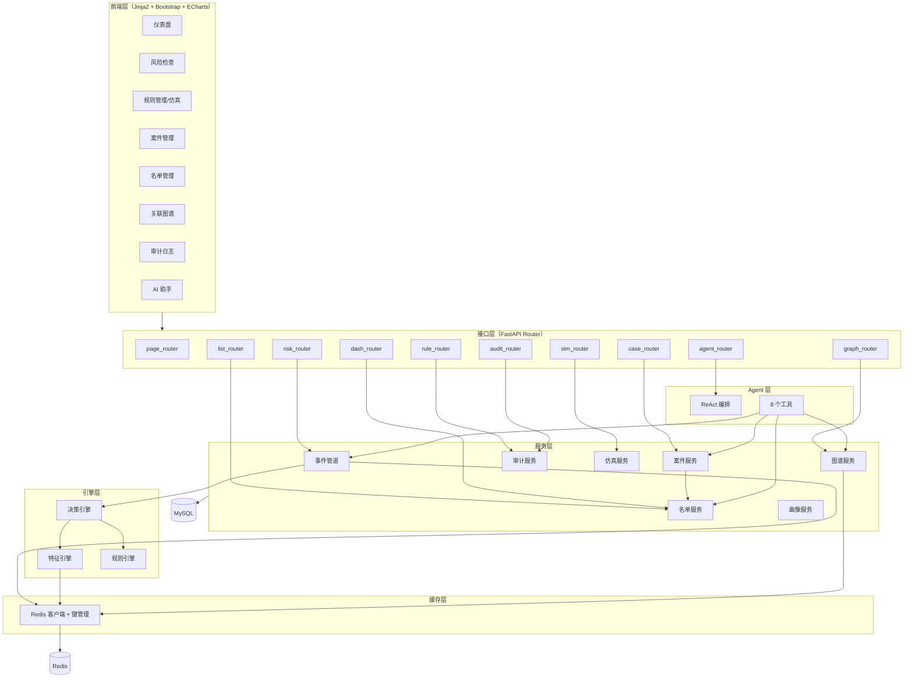
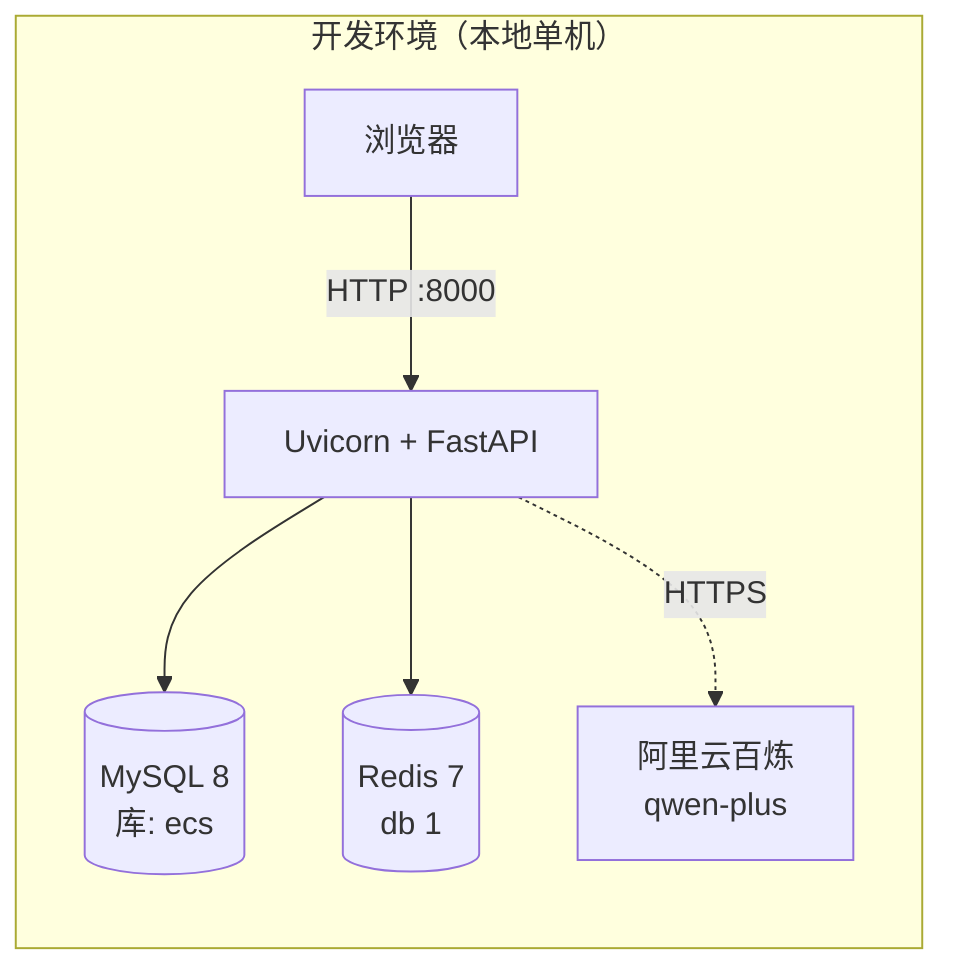
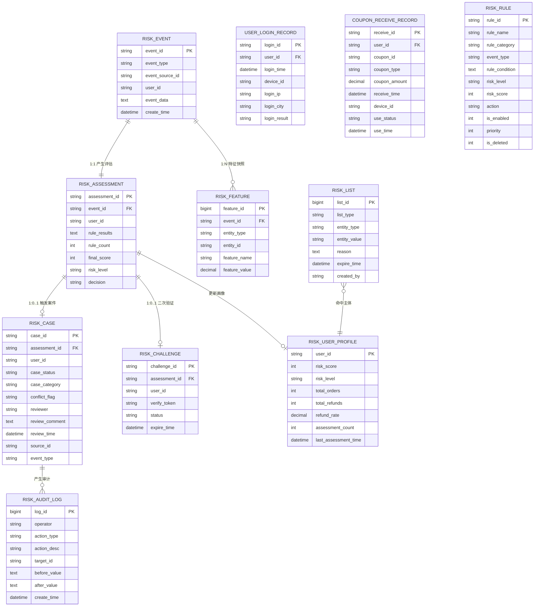
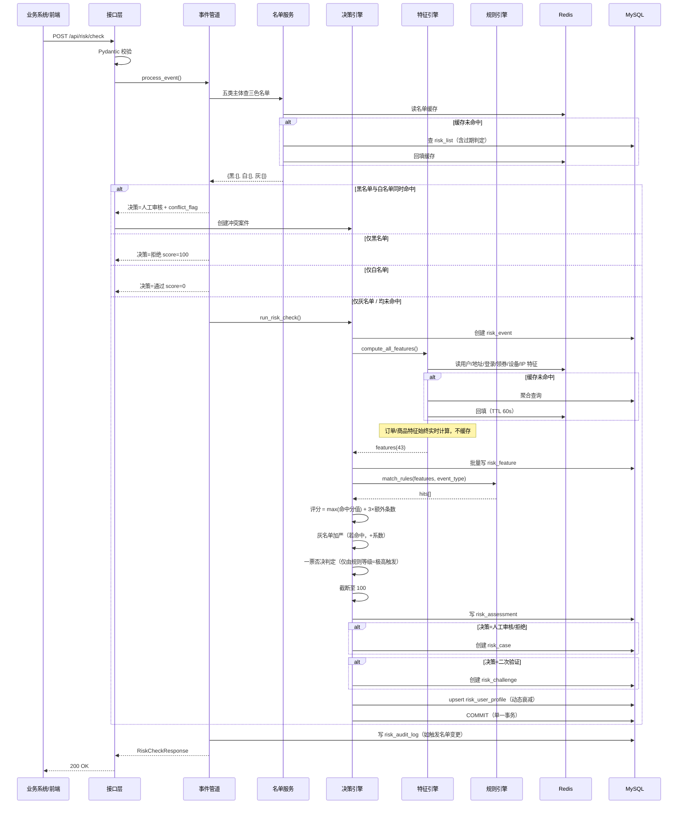
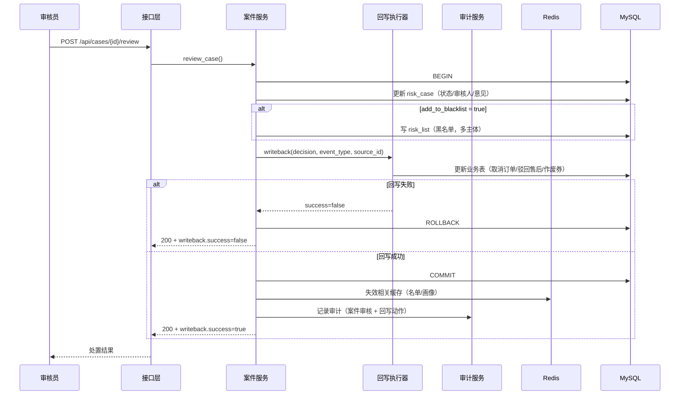
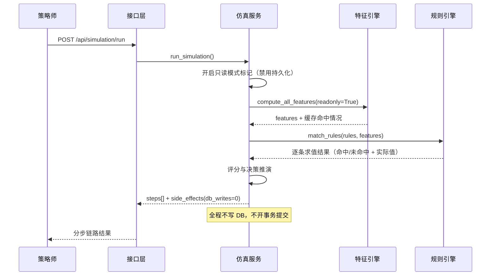

# 电商风控系统 技术设计规格说明书（Design Spec）

> | 文档名称 | 技术设计规格说明书 |
> |----------|-------------------|
> | 版本 | v1.3 |
> | 架构师角色 | 系统架构师 |
> | 日期 | 2026-10-13 |
> | 状态 | 评审稿 |
> | 依据 PRD | 电商风控系统 需求规格说明书 v1.3（54 条 FR / 43 特征 / 41 规则） |
> | 参考实现 | 尚硅谷 AI_Risk 参考代码（FastAPI + 规则引擎 + LangGraph Agent） |

---

## 1. 架构设计概述

### 1.1 架构风格

**模块化单体（Modular Monolith）+ 五层分层架构 + 轻量缓存旁路**

```
前端层（Jinja2 SSR + 局部异步）
    ↓
接口层（FastAPI Router，按业务域分模块）
    ↓
服务层（事件管道 / 案件 / 名单 / 画像 / 图谱 / 审计 / 仿真）
    ↓
引擎层（特征引擎 → 规则引擎 → 决策引擎）
    ↓
数据层（SQLAlchemy ORM）
    ↓
MySQL（主存储） + Redis（缓存旁路，可降级）
```

### 1.2 选型理由与权衡

| 决策 | 选择 | 理由 | 放弃了什么 |
|------|------|------|-----------|
| 部署形态 | **单体**，非微服务 | 模拟项目、单机部署、低并发（设计目标 30 连接）。微服务会带来服务注册、链路追踪、分布式事务等无收益成本 | 独立伸缩能力；但可通过模块边界清晰为未来拆分留口 |
| 分层方式 | **垂直分层**（层间单向依赖），非水平切分 | 风控的核心链路是「特征→规则→决策」的强顺序流程，分层比按业务域切分更贴合 | 单层变更需整体回归 |
| 渲染方式 | **服务端渲染 + 局部异步**（延续参考实现） | 已有 Jinja2 + Bootstrap 5 页面基础；图表与实时事件流用前端异步补齐 | 前后端完全分离的开发体验 |
| 缓存 | **Redis 缓存旁路**（Cache-Aside），非进程内缓存 | 进程内缓存多进程部署会不一致；Redis 可共享且可降级 | 引入一个新的中间件依赖（需接受） |
| 一致性 | **写后失效**（Write-Invalidate），非双写 | 风控是读多写少场景，写后删缓存比更新缓存更安全 | 首次读会有一miss |
| 名单建模 | **单表 + 类型字段**（三色 × 五类） | 三张表会导致判定逻辑三分支；单表查询一次拿全 | 单表行数增长较快（可接受，有归档机制） |

---

## 2. 技术栈与依赖

| 层 | 技术选型 | 版本 | 用途 | 来源 |
|----|---------|------|------|------|
| 语言 | Python | 3.12 | 后端 | 既定 |
| Web 框架 | FastAPI | 0.115 | 异步 API 服务 | 既定 |
| ORM | SQLAlchemy | 2.0（Mapped 声明式） | 数据库映射 | 既定 |
| 校验 | Pydantic | 2.x | 请求/响应契约 | 既定 |
| 配置 | pydantic-settings | 2.x | .env 加载 | 既定 |
| 数据库 | MySQL | 8.x（+ PyMySQL） | 业务与风控数据 | 既定 |
| **缓存** | **Redis** | **7.x（+ redis-py）** | **热点数据缓存** | **本次引入** |
| 模板 | Jinja2 | 3.1 | 服务端页面渲染 | 既定 |
| 前端 UI | Bootstrap | 5.3 | 响应式界面 | 既定 |
| **图表** | **ECharts** | **5.x（CDN）** | **趋势/环形/瀑布图** | **本次引入** |
| Agent | LangGraph + LangChain | 1.1 / 1.2 | ReAct Agent + 工具调用 | 既定 |
| LLM | 阿里云百炼（qwen-plus） | — | 大语言模型服务 | 既定 |
| **表格导入** | **openpyxl** | **3.1** | **名单批量导入** | **本次引入** |
| ID 生成 | ulid | — | 有序唯一 ID | 既定 |
| 测试 | pytest | 8.3 | 单元与集成测试 | 既定 |

**第三方依赖清单**（`requirements.txt`）：

```
fastapi==0.115.*
uvicorn[standard]==0.32.*
sqlalchemy==2.0.*
pymysql==1.1.*
pydantic==2.*
pydantic-settings==2.*
jinja2==3.1.*
redis==5.*            # 本次引入
openpyxl==3.1.*       # 本次引入
python-ulid==3.*
langgraph==1.1.*
langchain==1.2.*
langchain-community==0.3.*
dashscope==1.*
pytest==8.3.*
httpx==0.27.*
```

> ECharts 通过 CDN 引入，不进入 Python 依赖。

---

## 3. 模块 / 服务划分

### 3.1 模块拓扑



### 3.2 模块职责边界

| 模块 | 做什么 | **不做什么** |
|------|--------|-------------|
| **接口层** | 参数校验（Pydantic）、路由分发、异常转换为 HTTP 响应、页面渲染 | 不含业务逻辑；不直接查库（只调服务层） |
| **引擎层 - 特征引擎** | 计算 43 个特征、返回 `dict[str, float]`、读写特征缓存 | 不做规则判定；不写业务表 |
| **引擎层 - 规则引擎** | 加载启用规则、JSON 条件求值、返回命中列表 | 不计算分值；不写库 |
| **引擎层 - 决策引擎** | 串联编排（特征→规则→评分→决策）、事务内持久化、触发案件/画像更新 | 不做名单判定（由事件管道前置处理）；不做处置回写 |
| **服务层 - 事件管道** | 入参兜底、名单前置判定（三色五类）、参数补全、调用决策引擎、二次验证生成 | 不实现评分算法 |
| **服务层 - 案件服务** | 案件查询/详情组装/审核处置/**处置回写业务系统**/统计 | 不负责案件创建（由决策引擎） |
| **服务层 - 名单服务** | 三色名单 CRUD、五类主体判定、批量导入、过期判定、定时归档 | 不做拦截决策（只返回判定结果） |
| **服务层 - 画像服务** | 画像 upsert、动态衰减加权计算、画像查询 | 不写评估结果 |
| **服务层 - 图谱服务** | 按设备/IP/地址/手机号做关联查询、多跳扩散（限跳数）、缓存 | 不做可视化渲染（前端职责） |
| **服务层 - 审计服务** | 记录关键操作（变更前后值）、审计查询 | 不提供更新/删除接口 |
| **服务层 - 仿真服务** | 单条分步仿真、批量回放、样本库读取 | **严禁产生任何数据写入** |
| **缓存层** | 键管理、读写封装、失效、**降级开关** | 不感知业务语义 |
| **Agent 层** | ReAct 编排、8 个工具定义、会话持久化 | 工具内部**复用服务层**，不重复实现业务逻辑 |
| **系统配置模块** | 决策阈值与引擎参数的读写与持久化、变更审计、健康度指标聚合、运维任务调度与手动触发 | 不负责前端渲染；不直接改写业务数据 |

---

## 4. 部署拓扑



**环境差异说明**：

| 环境 | 应用 | 数据库 | 缓存 | 说明 |
|------|------|--------|------|------|
| dev | `uvicorn app.main:app --reload` | 本地 MySQL，库 `ecs` | 本地 Redis，db 1 | 开启 `--reload`，日志 DEBUG |
| test | pytest + httpx | 本地 MySQL，库 `ecs_test` | Redis db 2（或内存 fake） | 每次运行前重建 schema |
| prod（模拟） | `uvicorn --workers 4` | 同 dev | 本地 Redis | 仅用于演示多进程下会话持久化有效 |

> **部署形态取舍**：本项目为教学/演示性质，不做容器化与 K8s 编排。Redis 与 MySQL 均部署在本机，通过 `.env` 配置连接串。Agent 会话持久化到 Redis，使 `--workers 4` 多进程部署下上下文不丢失（对应 FR-41）。

---

## 5. 数据模型（ER）

### 5.1 实体关系总览



### 5.2 表清单与变更说明

**业务侧（19 张，只读）**

原 17 张保持不变：`user_info`、`region`、`receive_info`、`product_category`、`sku_info`、`order_status`、`order_info`、`order_detail`、`logistics`、`order_logistics`、`logistics_company`、`logistics_complaint`、`logistics_complaints_record`、`postsale_status`、`postsale_reason`、`postsale`、`postsale_logistics`。

**新增 2 张**（DDL 见 5.3）：`user_login_record`、`coupon_receive_record`。

**风控侧（9 张，读写）**

| 表 | 状态 | 变更点 |
|----|------|-------|
| `risk_rule` | 改造 | 新增 `is_deleted`（逻辑删除，FR-12）；`rule_category` 枚举扩至 10 类；`action` 枚举新增「二次验证」 |
| `risk_event` | 改造 | `event_type` 枚举扩至 6 类（+登录、+营销领券） |
| `risk_feature` | 改造 | `entity_type` 枚举扩至 7 类（用户/订单/地址/登录/领券/设备/IP/商品/手机号 → 实际按前缀归为 5 类主实体 + 附实体） |
| `risk_assessment` | 不变 | — |
| `risk_case` | 改造 | 新增 `conflict_flag`（名单冲突标记） |
| `risk_blacklist` → **`risk_list`** | **重构** | 改为三色（`list_type`: 黑/白/灰）× 五类（`entity_type`: 用户/手机号/IP/设备/地址）；唯一键改为「list_type + entity_type + entity_value」 |
| `risk_user_profile` | 改造 | 评分口径改为动态衰减加权（无须改表结构，仅改写入逻辑） |
| **`risk_audit_log`** | **新增** | 操作审计流水（FR-39） |
| **`risk_challenge`** | **新增** | 二次验证记录（FR-04 Challenge 档） |
| **`risk_list_archive`** | **新增** | **名单归档表**（FR-42 过期归档；支撑历史名单独立检索，与审计流水互补） |

**合计 29 张表**（19 业务 + 10 风控）。

> **字段前缀与实体类型映射约定**（决策引擎落特征快照时使用）：
> `user_` → 用户；`order_` / `sku_` → 订单；`addr_` → 地址；`login_` → 登录；`coupon_` → 领券；`device_` → 设备；`ip_` → IP；`phone_` → 手机号。
> 该映射以**可扩展字典**实现（而非 if/elif 硬编码），新增维度只需加一行配置。

### 5.3 新增表 DDL

```sql
-- 用户登录记录表（登录事件风控的数据底座）
CREATE TABLE IF NOT EXISTS `user_login_record` (
  `login_id`     varchar(50)  NOT NULL COMMENT '登录记录ID',
  `user_id`      varchar(50)  NOT NULL COMMENT '用户ID',
  `login_time`   timestamp    NOT NULL COMMENT '登录时间',
  `device_id`    varchar(100) DEFAULT NULL COMMENT '设备标识',
  `login_ip`     varchar(50)  DEFAULT NULL COMMENT '登录IP',
  `login_city`   varchar(50)  DEFAULT NULL COMMENT '登录城市',
  `login_result` enum('成功','失败') NOT NULL DEFAULT '成功' COMMENT '登录结果',
  PRIMARY KEY (`login_id`),
  KEY `idx_login_user_time`   (`user_id`, `login_time`),
  KEY `idx_login_device_time` (`device_id`, `login_time`),
  KEY `idx_login_ip_time`     (`login_ip`, `login_time`),
  CONSTRAINT `login_user_fk` FOREIGN KEY (`user_id`) REFERENCES `user_info` (`user_id`)
) ENGINE=InnoDB DEFAULT CHARSET=utf8mb4 COMMENT='用户登录记录表';

-- 优惠券领取记录表（营销领券风控的数据底座）
CREATE TABLE IF NOT EXISTS `coupon_receive_record` (
  `receive_id`    varchar(50)  NOT NULL COMMENT '领取记录ID',
  `user_id`       varchar(50)  NOT NULL COMMENT '用户ID',
  `coupon_id`     varchar(50)  NOT NULL COMMENT '券标识',
  `coupon_type`   varchar(50)  NOT NULL COMMENT '券种',
  `coupon_amount` decimal(10,2) NOT NULL DEFAULT 0 COMMENT '券面金额',
  `receive_time`  timestamp    NOT NULL COMMENT '领取时间',
  `device_id`     varchar(100) DEFAULT NULL COMMENT '设备标识',
  `use_status`    enum('未使用','已使用','已过期') NOT NULL DEFAULT '未使用' COMMENT '使用状态',
  `use_time`      timestamp    NULL DEFAULT NULL COMMENT '使用时间',
  PRIMARY KEY (`receive_id`),
  KEY `idx_coupon_user_time`   (`user_id`, `receive_time`),
  KEY `idx_coupon_device_time` (`device_id`, `receive_time`),
  KEY `idx_coupon_type_time`   (`coupon_type`, `receive_time`),
  CONSTRAINT `coupon_user_fk` FOREIGN KEY (`user_id`) REFERENCES `user_info` (`user_id`)
) ENGINE=InnoDB DEFAULT CHARSET=utf8mb4 COMMENT='优惠券领取记录表';

-- 名单表（三色 × 五类主体）
CREATE TABLE IF NOT EXISTS `risk_list` (
  `list_id`      bigint       NOT NULL AUTO_INCREMENT COMMENT '名单ID',
  `list_type`    enum('黑名单','白名单','灰名单') NOT NULL COMMENT '名单类型',
  `entity_type`  enum('用户','手机号','IP','设备','地址') NOT NULL COMMENT '主体类型',
  `entity_value` varchar(200) NOT NULL COMMENT '主体值',
  `reason`       text         DEFAULT NULL COMMENT '加入原因/准入凭据',
  `expire_time`  datetime     DEFAULT NULL COMMENT '过期时间(NULL=永久)',
  `created_by`   varchar(50)  DEFAULT NULL COMMENT '操作人',
  `create_time`  timestamp    NOT NULL DEFAULT CURRENT_TIMESTAMP COMMENT '创建时间',
  PRIMARY KEY (`list_id`),
  UNIQUE KEY `uk_list_type_entity` (`list_type`, `entity_type`, `entity_value`),
  KEY `idx_list_lookup` (`entity_type`, `entity_value`, `expire_time`)
) ENGINE=InnoDB DEFAULT CHARSET=utf8mb4 COMMENT='风控名单表(黑白灰)';

-- 操作审计流水表（仅追加，不提供更新/删除接口）
CREATE TABLE IF NOT EXISTS `risk_audit_log` (
  `log_id`       bigint      NOT NULL AUTO_INCREMENT COMMENT '日志ID',
  `operator`     varchar(50) NOT NULL COMMENT '操作人',
  `action_type`  enum('规则','名单','案件','配置') NOT NULL COMMENT '操作类别',
  `action_desc`  varchar(100) NOT NULL COMMENT '操作描述(新增/修改/删除/启停/审核/回写)',
  `target_id`    varchar(50) NOT NULL COMMENT '操作对象ID',
  `before_value` text        DEFAULT NULL COMMENT '变更前值(JSON)',
  `after_value`  text        DEFAULT NULL COMMENT '变更后值(JSON)',
  `create_time`  timestamp   NOT NULL DEFAULT CURRENT_TIMESTAMP COMMENT '操作时间',
  PRIMARY KEY (`log_id`),
  KEY `idx_audit_type_time`   (`action_type`, `create_time`),
  KEY `idx_audit_target`      (`target_id`),
  KEY `idx_audit_operator`    (`operator`, `create_time`)
) ENGINE=InnoDB DEFAULT CHARSET=utf8mb4 COMMENT='风控操作审计流水表';

-- 二次验证记录表
CREATE TABLE IF NOT EXISTS `risk_challenge` (
  `challenge_id`  varchar(50) NOT NULL COMMENT '验证ID',
  `assessment_id` varchar(50) NOT NULL COMMENT '关联评估ID',
  `user_id`       varchar(50) NOT NULL COMMENT '用户ID',
  `verify_token`  varchar(100) NOT NULL COMMENT '验证凭据(模拟通道占位)',
  `status`        enum('待验证','已验证','已超时') NOT NULL DEFAULT '待验证' COMMENT '验证状态',
  `expire_time`   datetime    NOT NULL COMMENT '验证过期时间',
  `create_time`   timestamp   NOT NULL DEFAULT CURRENT_TIMESTAMP COMMENT '创建时间',
  PRIMARY KEY (`challenge_id`),
  KEY `idx_challenge_status` (`status`, `expire_time`),
  CONSTRAINT `challenge_assessment_fk` FOREIGN KEY (`assessment_id`) REFERENCES `risk_assessment` (`assessment_id`)
) ENGINE=InnoDB DEFAULT CHARSET=utf8mb4 COMMENT='二次验证记录表';

-- 名单归档表（FR-42：过期名单清理前的落脚点）
-- 与 risk_audit_log 的分工：审计流水记录「操作」，本表记录「数据」，
-- 按主体维度可独立检索历史名单（如「某设备历史上被拉黑过几次」）。
-- 不设唯一约束：同一主体可被反复加入 / 移除，产生多条归档记录。
CREATE TABLE IF NOT EXISTS `risk_list_archive` (
  `archive_id`       bigint       NOT NULL AUTO_INCREMENT COMMENT '归档ID',
  `original_list_id` bigint       NOT NULL COMMENT '原名单ID',
  `list_type`        enum('黑名单','白名单','灰名单') NOT NULL COMMENT '名单类型',
  `entity_type`      enum('用户','手机号','IP','设备','地址') NOT NULL COMMENT '主体类型',
  `entity_value`     varchar(200) NOT NULL COMMENT '主体值',
  `reason`           text         COMMENT '原加入原因/准入凭据',
  `expire_time`      datetime     DEFAULT NULL COMMENT '原过期时间',
  `created_by`       varchar(50)  DEFAULT NULL COMMENT '原操作人',
  `create_time`      datetime     DEFAULT NULL COMMENT '原创建时间',
  `archive_time`     datetime     NOT NULL DEFAULT CURRENT_TIMESTAMP COMMENT '归档时间',
  `archived_by`      varchar(50)  DEFAULT NULL COMMENT '归档触发者',
  `archive_reason`   varchar(100) DEFAULT NULL COMMENT '归档原因',
  PRIMARY KEY (`archive_id`),
  KEY `idx_archive_entity`    (`entity_type`, `entity_value`),
  KEY `idx_archive_type_time` (`list_type`, `archive_time`),
  KEY `idx_archive_time`      (`archive_time`)
) ENGINE=InnoDB DEFAULT CHARSET=utf8mb4 COMMENT='名单归档表';
```

### 5.4 既有表改造 DDL（增量脚本）

```sql
-- risk_rule: 逻辑删除 + 枚举扩展
ALTER TABLE risk_rule ADD COLUMN is_deleted tinyint NOT NULL DEFAULT 0 COMMENT '逻辑删除标记' AFTER priority;
ALTER TABLE risk_rule MODIFY COLUMN rule_category
  ENUM('订单欺诈','支付风险','账户风险','售后滥用','地址风险','物流风险','登录安全','营销薅羊毛','黄牛囤货','聚集风险') NOT NULL;
ALTER TABLE risk_rule MODIFY COLUMN action
  ENUM('通过','标记','人工审核','二次验证','拒绝') NOT NULL;

-- risk_event: 事件类型扩展
ALTER TABLE risk_event MODIFY COLUMN event_type
  ENUM('登录','营销领券','下单','支付','售后申请','物流投诉') NOT NULL;

-- risk_case: 名单冲突标记
ALTER TABLE risk_case ADD COLUMN conflict_flag tinyint NOT NULL DEFAULT 0 COMMENT '是否名单冲突案件' AFTER case_category;

-- risk_blacklist → risk_list 数据迁移（三色五类）
RENAME TABLE risk_blacklist TO risk_list;
ALTER TABLE risk_list ADD COLUMN list_type ENUM('黑名单','白名单','灰名单') NOT NULL DEFAULT '黑名单' AFTER list_id;
ALTER TABLE risk_list ADD COLUMN created_by varchar(50) DEFAULT NULL COMMENT '操作人' AFTER expire_time;
ALTER TABLE risk_list CHANGE COLUMN blacklist_type entity_type ENUM('用户','手机号','IP','设备','地址') NOT NULL COMMENT '主体类型';
ALTER TABLE risk_list CHANGE COLUMN blacklist_value entity_value varchar(200) NOT NULL COMMENT '主体值';
```

> 迁移脚本须幂等（用 `INFORMATION_SCHEMA` 判断列是否存在后再执行），保证可重复运行。

---

## 6. 关键接口定义

### 6.1 接口清单（44 个已定义端点 / 12 个 Router）

| 编号 | 方法 | 路径 | 说明 | 对应 FR |
|------|------|------|------|---------|
| API-01 | POST | `/api/risk/check` | 实时风险检查（6 类事件） | FR-01 |
| API-02 | GET | `/api/rules` | 规则列表（分类筛选、排除已删除） | FR-08 |
| API-03 | GET | `/api/rules/{rule_id}` | 规则详情 | FR-08 |
| API-04 | POST | `/api/rules` | 新增规则 | FR-09 |
| API-05 | PUT | `/api/rules/{rule_id}` | 编辑规则（部分更新） | FR-10 |
| API-06 | PUT | `/api/rules/{rule_id}/toggle` | 启停规则 | FR-11 |
| API-07 | DELETE | `/api/rules/{rule_id}` | **逻辑删除**规则 | FR-12 |
| API-08 | POST | `/api/rules/validate` | 校验条件表达式格式 | FR-13 |
| API-09 | GET | `/api/cases` | 案件列表（状态/分类/冲突筛选 + 分页） | FR-15 |
| API-10 | GET | `/api/cases/statistics` | 案件统计 | FR-19 |
| API-11 | GET | `/api/cases/{case_id}` | 案件详情（规则+快照+画像+图谱+业务单据） | FR-16 |
| API-12 | POST | `/api/cases/{case_id}/review` | 案件审核（含**处置回写**） | FR-17、FR-48 |
| API-13 | GET | `/api/lists` | 名单列表（颜色/主体类型筛选） | FR-21 |
| API-14 | POST | `/api/lists` | 新增名单项 | FR-22 |
| API-15 | DELETE | `/api/lists/{list_id}` | 移除名单项 | FR-23 |
| API-16 | **POST** | **`/api/lists/import`** | **名单批量导入（Excel/CSV）** | **FR-49** |
| API-17 | GET | `/api/lists/template` | 下载导入模板 | FR-49 |
| API-18 | **GET** | **`/api/graph`** | **关联图谱查询（多跳）** | **FR-07** |
| API-19 | GET | `/api/profile/{user_id}` | 用户画像 | FR-25 |
| API-20 | **GET** | **`/api/dashboard/loss-prevention`** | **资损防护统计** | **FR-50** |
| API-21 | **GET** | **`/api/dashboard/realtime`** | **实时事件流（最近 N 条）** | **FR-51** |
| API-22 | GET | `/api/dashboard/overview` | 大盘概览（含拦截率、风险分布） | FR-26~FR-28 |
| API-23 | **POST** | **`/api/simulation/run`** | **单条事件仿真（分步链路）** | **FR-14** |
| API-24 | **POST** | **`/api/simulation/replay`** | **批量回放（含样本库载入）** | **FR-14、FR-52** |
| API-25 | GET | `/api/simulation/samples` | 作弊样本库列表 | FR-52 |
| API-26 | **GET** | **`/api/audit-logs`** | **审计流水查询** | **FR-39** |
| API-27 | **POST** | **`/api/challenge/{challenge_id}/verify`** | **二次验证提交** | **FR-04** |
| API-28 | POST | `/api/agent/chat` | AI 助手对话 | FR-29 |
| API-29 | POST | `/api/agent/clear` | 清除会话 | FR-32 |
| API-30~37 | GET | `/`、`/rules`、`/cases`、`/lists`、`/risk-check`、`/graph`、`/audit`、`/chat` | 8 个页面路由 | FR-33~37、FR-44、FR-47 |
| API-46 | GET | `/api/settings/thresholds` | 读取当前决策阈值与引擎参数 | **FR-56** |
| API-47 | **PUT** | **`/api/settings/thresholds`** | **在线调整阈值与引擎参数（写审计、记录前后值）** | **FR-56** |
| API-48 | GET | `/api/settings/cache-policy` | 读取缓存与降级策略 | **FR-56** |
| API-49 | PUT | `/api/settings/cache-policy` | 调整缓存开关与 TTL | **FR-56** |
| API-50 | **GET** | **`/api/health/metrics`** | **健康度指标（P95 / 调用量 / 错误率 / 缓存命中率 / 耗时分解）** | **FR-56** |
| API-51 | GET | `/api/health/tasks` | 运维任务状态（归档 / 预热 / 健康检查） | FR-42、FR-56 |
| API-52 | POST | `/api/health/tasks/{task}/run` | 手动触发运维任务 | FR-42 |
| API-38~45 | — | 预留 | 其余运维接口（未定义，不纳入实现范围） | — |

> **端点计数口径**（v1.4 统一）：
> 本表共 **44 个已定义端点** = API-01~37（其中 API-28/29 属 Agent 层、API-30~37 属页面路由）
> + API-46~52；**API-38~45 为预留未定义，不计入**。
> 实现时另追加了 10 个便利端点（不计入上表），故 T-17 交付的接口层实际暴露 44 条 `/api` 路由：
>
> | 追加端点 | 用途 |
> |---|---|
> | `GET /api/rules/statistics` | 规则分类统计（规则页头部） |
> | `GET /api/lists/statistics` | 名单三色 × 五类分布 |
> | `GET /api/lists/archived` | **历史名单独立检索**（FR-42 归档表） |
> | `GET /api/lists/subject-history` | 某主体的名单履历（当前生效 + 历史归档） |
> | `GET /api/profile` | 画像列表 |
> | `POST /api/profile/{user_id}/rebuild` | 按历史评估重放重算（运维） |
> | `GET /api/graph/related-accounts` | 聚集判定辅助（FR-07 验收 3） |
> | `POST /api/challenge/expire-scan` | 手动扫描超时验证并升级（运维） |
> | `GET /api/settings/runtime-overrides` | 查看运行时配置覆盖项 |
> | `POST /api/health/perf/reset` | 重置性能采样 |

### 6.2 核心接口契约

#### API-01 实时风险检查

**请求** `POST /api/risk/check`

```json
{
  "event_type": "登录",
  "source_id": "LOGIN_TEST_001",
  "user_id": "U7001",
  "order_id": null,
  "receive_id": null,
  "event_data": {
    "device_id": "D-8891",
    "login_ip": "10.20.30.40",
    "login_city": "深圳市"
  }
}
```

| 字段 | 类型 | 必填 | 说明 |
|------|------|------|------|
| event_type | enum | 是 | `登录` / `营销领券` / `下单` / `支付` / `售后申请` / `物流投诉` |
| source_id | string(50) | 是 | 关联业务 ID |
| user_id | string(50) | 是 | 用户 ID，必须存在 |
| order_id | string(50) | 否 | 未传时按事件类型自动推导 |
| receive_id | string(50) | 否 | 未传时从订单反查 |
| event_data | object | 否 | 事件上下文（设备、IP 等） |

**响应** `200 OK`

```json
{
  "assessment_id": "ast01j...",
  "event_id": "evt01j...",
  "user_id": "U7001",
  "final_score": 78,
  "risk_level": "高",
  "decision": "人工审核",
  "rule_count": 2,
  "triggered_rules": [
    { "rule_id": "L002", "rule_name": "同设备多账号登录", "rule_category": "登录安全",
      "risk_level": "高", "risk_score": 75, "action": "人工审核", "description": "..." },
    { "rule_id": "L001", "rule_name": "短时高频登录失败", "rule_category": "登录安全",
      "risk_level": "高", "risk_score": 70, "action": "人工审核", "description": "..." }
  ],
  "features": { "login_fail_count_1h": 7, "device_account_count_24h": 4, "...": "..." },
  "list_hit": { "type": "无", "entities": [] },
  "cache_hit": { "user_features": true, "order_features": false },
  "create_time": "2026-10-13T21:30:00"
}
```

> **相比参考实现新增的响应字段**：`list_hit`（名单命中情况，便于前端展示与排查）、`cache_hit`（缓存命中情况，对应 S-11 可验证性）。

#### API-18 关联图谱查询

**请求** `GET /api/graph?entity_type=用户&entity_value=U5001&hops=2`

| 参数 | 类型 | 默认 | 说明 |
|------|------|------|------|
| entity_type | enum | — | `用户` / `手机号` / `IP` / `设备` / `地址` |
| entity_value | string | — | 主体值 |
| hops | int | 2 | 跳数上限，最大 3（NFR-06） |

**响应** `200 OK`

```json
{
  "center": { "type": "用户", "value": "U5001" },
  "hops": 2,
  "nodes": [
    { "id": "用户:U5001", "type": "用户", "value": "U5001", "risk_score": 78, "is_center": true },
    { "id": "设备:D-8891", "type": "设备", "value": "D-8891", "linked_accounts": 3 },
    { "id": "用户:U5002", "type": "用户", "value": "U5002", "risk_score": 45, "is_center": false }
  ],
  "edges": [
    { "source": "用户:U5001", "target": "设备:D-8891", "relation": "使用" },
    { "source": "用户:U5002", "target": "设备:D-8891", "relation": "使用" }
  ],
  "truncated": false,
  "truncate_reason": null
}
```

> `truncated=true` 表示因跳数或节点数上限被截断，前端需提示「仅展示部分关联」。

#### API-12 案件审核（含处置回写）

**请求** `POST /api/cases/{case_id}/review`

```json
{
  "decision": "已拒绝",
  "reviewer": "reviewer_zhang",
  "review_comment": "确认盗号，订单金额与用户历史行为严重不符",
  "add_to_blacklist": true,
  "blacklist_entity_types": ["用户", "设备"]
}
```

**响应** `200 OK`（含回写结果）

```json
{
  "case_id": "cas01j...",
  "case_status": "已拒绝",
  "reviewer": "reviewer_zhang",
  "review_time": "2026-10-13T21:40:00",
  "blacklist_added": [
    { "entity_type": "用户", "entity_value": "U7001" },
    { "entity_type": "设备", "entity_value": "D-8891" }
  ],
  "writeback": {
    "attempted": true,
    "success": true,
    "action": "取消未支付订单",
    "target": "ORD20261013001",
    "affected_rows": 1
  },
  "audit_log_id": 10231
}
```

**回写失败时的响应** `200 OK`（业务失败但 HTTP 成功，事务已回滚）

```json
{
  "case_id": "cas01j...",
  "case_status": "待审核",
  "writeback": {
    "attempted": true,
    "success": false,
    "action": "取消未支付订单",
    "target": "ORD20261013001",
    "error": "订单已进入发货流程，不可取消"
  },
  "message": "处置回写失败，案件状态未推进，请人工处理后再试"
}
```

#### API-23 规则仿真

**请求** `POST /api/simulation/run`

```json
{
  "event_type": "登录",
  "user_id": "U7001",
  "source_id": "LOGIN_TEST_01",
  "event_data": { "device_id": "D-8891", "login_ip": "10.20.30.40" },
  "rule_set": "current"
}
```

**响应** `200 OK`（**分步链路**，对应 AC-30）

```json
{
  "simulation_id": "sim01j...",
  "steps": [
    {
      "step": 1,
      "name": "名单判定",
      "result": { "hit": false, "detail": "五类主体均未命中黑/白/灰名单" }
    },
    {
      "step": 2,
      "name": "特征提取",
      "result": {
        "features": { "login_fail_count_1h": 7, "device_account_count_24h": 4, "login_count_1h": 9 },
        "cache_hit": { "user_features": false }
      }
    },
    {
      "step": 3,
      "name": "规则求值",
      "result": {
        "evaluated": 12,
        "hits": [
          { "rule_id": "L001", "hit": true, "risk_score": 70, "condition": "login_fail_count_1h >= 5", "actual": 7 },
          { "rule_id": "L002", "hit": true, "risk_score": 75, "condition": "device_account_count_24h >= 3", "actual": 4 },
          { "rule_id": "L004", "hit": false, "risk_score": 90, "condition": "login_is_new_device == 1 AND login_city_count_7d >= 3", "actual": "login_is_new_device=0" }
        ]
      }
    },
    {
      "step": 4,
      "name": "评分与决策",
      "result": { "max_score": 75, "extra_rules": 1, "bonus": 3, "final_score": 78,
                  "veto": false, "risk_level": "高", "decision": "人工审核" }
    }
  ],
  "side_effects": { "db_writes": 0, "cases_created": 0 }
}
```

> `side_effects` 字段显式声明无副作用，用于验收（AC-30）。

### 6.3 错误码体系

| 段位 | 前缀 | 含义 | 示例 |
|------|------|------|------|
| 1xxx | `BIZ_` | 业务规则错误（可重试/需用户修正） | `BIZ_USER_NOT_FOUND`、`BIZ_EVENT_TYPE_INVALID`、`BIZ_LIST_CONFLICT_BLACKLIST`、`BIZ_WRITEBACK_FAILED` |
| 2xxx | `SYS_` | 系统/依赖错误 | `SYS_DB_UNAVAILABLE`、`SYS_CACHE_UNAVAILABLE`（**警告级，不阻断**）、`SYS_LLM_TIMEOUT` |
| 3xxx | `AUTH_` | 鉴权（本期未启用，预留） | `AUTH_TOKEN_EXPIRED` |

**统一错误响应体**：

```json
{
  "code": "BIZ_LIST_CONFLICT_BLACKLIST",
  "message": "该主体已在黑名单中，请先移除黑名单再加入白名单",
  "detail": { "entity_type": "用户", "entity_value": "U8888" }
}
```

**关键约定**：
1. **缓存不可用属于警告级**（`SYS_CACHE_UNAVAILABLE`），只记日志不返回错误 —— 对应 NFR-14「缓存故障不影响风控主链路」
2. `BIZ_WRITEBACK_FAILED` 的场景下 HTTP 仍返回 200，由响应体的 `writeback.success=false` 表达（见 API-12）
3. 规则条件求值失败**不抛异常**，仅记警告并判定为不命中（对应 FR-03）

### 6.4 OpenAPI 片段示例

```yaml
paths:
  /api/lists:
    post:
      summary: 新增名单项
      tags: [名单管理]
      requestBody:
        required: true
        content:
          application/json:
            schema:
              type: object
              required: [list_type, entity_type, entity_value]
              properties:
                list_type:
                  type: string
                  enum: [黑名单, 白名单, 灰名单]
                entity_type:
                  type: string
                  enum: [用户, 手机号, IP, 设备, 地址]
                entity_value: { type: string, maxLength: 200 }
                reason: { type: string }
                expire_time: { type: string, format: date-time, nullable: true }
                created_by: { type: string }
      responses:
        '201':
          description: 创建成功
        '400':
          description: 参数错误 / 白名单未设有效期
          content:
            application/json:
              schema:
                type: object
                properties:
                  code:    { type: string, example: BIZ_LIST_EXPIRE_REQUIRED }
                  message: { type: string, example: 白名单必须设置有效期且不超过 90 天 }
```

### 6.5 处置回写状态映射（Q2 决策）

> 回写执行器根据「事件类型 + 业务单据当前状态」决定是否回写及回写动作。**不在允许范围内的状态一律不回写**，仅记录处置结论。

| 事件类型 | 业务单据状态 | 允许回写 | 回写动作 | 说明 |
|---------|-------------|:-------:|---------|------|
| 下单 | 未支付 | ✓ | 订单状态 → 已取消 | 交易未发生，直接取消无副作用 |
| 下单 | 已支付、未发货 | ✓ | 标记为「风控拦截」并**发起退款流程** | **不直接退款**，转退款流程人工确认 |
| 下单 | 已发货 / 已完成 | ✗ | — | 货已出，须走售后流程，风控不越权改写业务终态 |
| 支付 | 支付中 / 已支付 | ✓ | 标记订单为风控拦截，阻止后续发货 | — |
| 售后申请 | 待审核 / 处理中 | ✓ | 售后单状态 → 已驳回 | — |
| 售后申请 | 已完成 / 已关闭 | ✗ | — | 已终结的单据不回写 |
| 登录 | — | ✓ | 强制该会话下线，要求重新验证 | 记录下线动作 |
| 营销领券 | 未使用 | ✓ | 券状态 → 已作废 | — |
| 营销领券 | 已使用 / 已过期 | ✗ | — | 已消费或已失效，无法回写 |

**实现约束**：

1. 回写动作与目标状态**必须以映射表形式集中定义**（不允许散落在业务分支的 `if/else` 里），便于审计与扩展
2. 回写前需**二次校验当前状态**（避免并发场景下基于过期状态改写），校验失败则整个事务回滚
3. 每条回写记录 `{事件类型, 原状态, 新状态, 目标ID, 结果}` 写入案件详情的 `writeback` 字段，并同步写入审计流水
4. 状态取值以 `order_status` / `postsale_status` 两张业务字典表的实际值为准，**不得硬编码中文状态串以外的新值**

---

## 7. 关键流程时序图

### 7.1 实时风控检查（含名单裁决 + 缓存 + 图谱）



### 7.2 案件审核与处置回写



### 7.3 规则仿真回放（无副作用）



---

## 8. 非功能设计

| 维度 | 指标（来自 PRD） | 设计手段 |
|------|----------------|---------|
| **安全** | 敏感配置不落代码（NFR-07） | pydantic-settings 从 `.env` 加载；`.env` 加入 `.gitignore` |
| 安全 | SQL 注入防护（NFR-08） | 全部使用 SQLAlchemy `text()` 参数绑定或 ORM 表达式；**禁止 f-string 拼接 SQL**；AI 工具的 `query_business_data` 使用预定义查询模板白名单 |
| 安全 | AI 工具不得擅自改数据 | 名单写操作（新增 / 移除）**必须带 `confirm=true` 才执行**：模型先复述意图、取得用户明确同意，再带 `confirm` 重新调用；未确认的调用返回「需要确认」的提示而不是报错，让模型有机会走完确认流程。白名单另受两道硬约束：有效期必填且 ≤ 90 天（超限需 `force=true` 二次确认）、主体已在黑名单时不得直接加白 |
| 安全 | 规则求值不执行任意代码（NFR-11） | 白名单运算符 `if/elif` 分发，**不使用 `eval` / `exec` / 第三方沙箱库**；未知 op 返回 False + 警告 |
| 安全 | 跨主体信息保护（NFR-12） | 聚集类特征**只返回计数值**（如 `device_account_count_24h=4`），不返回其他账号 ID；其他账号仅在 `/api/graph` 按权限展开 |
| 安全 | 输入校验（NFR-09） | 全部请求经 Pydantic 模型校验；枚举用 `Literal` 约束；分值与跳数用 `Field(ge, le)` 约束 |
| **性能** | 单次检查 P95 < 500ms（NFR-01） | ① 缓存旁路降低聚合查询次数；② 特征 SQL 涉及的字段建索引（`user_id`、`device_id`、`login_time`）；③ 特征快照批量插入（`bulk_save_objects`）替代逐条 `add`；④ 5 张表在**单事务**内提交，减少往返 |
| 性能 | 缓存 TTL 与范围（NFR-05） | 用户/地址/登录/领券/设备/IP 特征 TTL=60s；画像与图谱 TTL=300s；**订单/商品特征不缓存** |
| 性能 | 图谱查询跳数上限（NFR-06） | 邻接查询按跳迭代，每跳限制最大节点数（默认 200），超限截断并返回 `truncated=true` |
| 性能 | 仪表盘加载 < 2s（NFR-03） | 聚合结果缓存 60s；规则命中 TOP5 用数据库侧 JSON 展开聚合（避免全量拉回内存） |
| **高可用** | 数据库断连自恢复（NFR-13） | `pool_pre_ping=True`；连接池 `pool_size=10, max_overflow=20` |
| 高可用 | 缓存故障降级（NFR-14） | 缓存层封装 `safe_get/safe_set`，异常被捕获 → 记警告日志 → 返回 None → 业务直查数据库。**缓存异常不向上传播** |
| 高可用 | 会话不因重启丢失（FR-41） | Agent 会话持久化到 Redis（`risk:agent:sess:{session_id}`，TTL 24h），替代参考实现的进程内 dict |
| **可观测** | 关键路径日志（NFR-19） | 规则命中（规则 ID + 分值）、名单拦截/放行、案件创建、回写动作、缓存命中等均打 INFO 日志；异常打 WARNING 并保留上下文 |
| 可观测 | 性能可验证（S-11） | 响应体返回 `cache_hit` 字段；日志记录每次检查的 SQL 次数与耗时，便于压测分析 |
| **合规** | 审计完整性 100%（NFR-20） | 审计写入封装为 `audit_service.log()`，规则/名单/案件/配置四类操作**强制调用**；单元测试断言覆盖率 |
| 合规 | 审计不可篡改（NFR-21） | `risk_audit_log` 只提供 INSERT 与 SELECT；不暴露 UPDATE/DELETE 接口；模型层不定义变更方法 |
| **可维护** | 分层单向依赖（NFR-16） | 接口层→服务层→引擎层→数据层；**禁止反向 import**；用 `import-linter` 或 code review 检查 |
| 可维护 | 规则热更新（NFR-17） | 规则不缓存在进程内；每次检查从 DB 读取启用规则（或缓存 60s + 写后失效），改库立即生效 |

---

## 9. 设计决策记录（ADR）

| 编号 | 决策 | 背景 / 选项 | 选择理由 | 后果 |
|------|------|------------|---------|------|
| **ADR-01** | 采用**模块化单体**而非微服务 | 选项：A 微服务拆分（特征/规则/案件/图谱各一服务）｜B 单体分层 | 模拟项目、单机部署、30 连接规模；微服务带来的服务发现、分布式事务、链路追踪成本无对应收益 | 单点部署；但模块边界清晰，未来可按服务层切开 |
| **ADR-02** | 缓存用 **Redis 旁路**而非进程内缓存 | 选项：A `functools.lru_cache` / 进程内 dict｜B Redis | 进程内缓存在 `--workers 4` 下互不可见且无法统一失效；Redis 支持写后失效与多进程共享 | 新增一个中间件依赖；必须实现降级（NFR-14） |
| **ADR-03** | 缓存策略用**写后失效**而非写时更新 | 选项：A 更新缓存｜B 删除缓存 | 风控是读多写少；并发下"更新缓存"容易产生旧值覆盖新值的竞态；删除后下次读自然回源，语义更安全 | 首次读会有一次 miss（可接受） |
| **ADR-04** | 名单用**单表三色五类**而非三张表 | 选项：A 黑/白/灰三张表｜B 单表 + list_type | 判定逻辑需要一次拿到三色结果；三张表会导致三分支查询与合并逻辑；单表一次查询即可 | 单表行数增长快（由 FR-42 归档机制缓解） |
| **ADR-05** | 规则条件求值用**白名单 if/elif**，拒绝 `eval` 与第三方沙箱 | 选项：A `eval`｜B `simpleeval`/`asteval`｜C 白名单硬编码 | `eval` 存在任意代码执行风险；第三方沙箱有 CVE 历史；风控合规要求求值路径 100% 可审计 | 新增运算符需改代码走 PR（视为可接受成本） |
| **ADR-06** | 图谱用**邻接查询**而非图数据库 | 选项：A Neo4j / NebulaGraph｜B MySQL 邻接查询 + 跳数限制 | 关联维度仅 4 类且跳数 ≤2；引入图数据库的运维成本远超收益；邻接查询配合索引可满足演示与性能要求 | 超大规模下图谱查询会变慢；已用跳数与节点数上限兜底 |
| **ADR-07** | 处置回写用**同步事务**而非消息队列 | 选项：A 发 MQ 异步回写｜B 同事务同步回写 | 回写必须与案件状态强一致（要么都成功要么都回滚）；引入 MQ 会带来最终一致性问题，且项目无 MQ | 回写耗时会拉长接口响应；已限定回写为单表轻量更新 |
| **ADR-08** | 接口层由单文件拆为**包**（`app/api/`） | 选项：A 继续单文件 `api.py`｜B 拆为 Router 包 | 需求从 27 个端点增至 44 个，单文件将超 800 行，难以维护与并行开发 | 目录层级增加一层；每个 Router 文件职责单一 |

---

## 10. 任务分解清单

> 按实现顺序排列，`依赖` 列标明前置任务。标注 **[并行]** 的可与相邻任务并行。

| 任务编号 | 模块 | 依赖 | 说明 |
|---------|------|------|------|
| **T-01** | 项目骨架 | 无 | 建目录结构、`requirements.txt`、`.env.example`、`config.py`、`database.py`、`main.py` 空壳 |
| **T-02** | 数据层 | T-01 | `models.py` 全量 ORM（19 业务只读 + 9 风控）；`sql/init_*` 建表脚本 |
| **T-03** | 数据层 | T-02 | 增量迁移脚本（`risk_rule.is_deleted`、`risk_list` 重构、`risk_case.conflict_flag` 等），须幂等 |
| **T-04** | 数据初始化 | T-02 | 生成 19 张业务表的模拟数据；**新增**登录记录、领券记录、商品囤货数据的生成脚本；**统一生成 `device_id`**（登录与领券记录共用设备池，用于构造「同设备多账号」聚集场景，对应 Q1 决策） |
| **T-05** | 数据初始化 | T-02 | 预置 41 条规则（R001~R024 + L001~L005 + C001~C005 + B001~B003 + A001~A004） |
| **T-06** | 缓存层 | T-01 | `cache.py`：Redis 客户端、`safe_get/safe_set/delete`、键命名规范、**降级封装** |
| **T-07** | 引擎层 - 特征 | T-02、T-06 | 43 个特征实现（9 个维度），统一返回 `dict[str, float]`；接入缓存 |
| **T-08** | 引擎层 - 规则 | T-02 | JSON 条件递归求值（9 比较符 + 2 逻辑符）、白名单运算符、容错处理 |
| **T-09** | 引擎层 - 决策 | T-07、T-08 | 评分公式、一票否决、灰名单加严、实体类型前缀映射、单事务持久化 |
| **T-10** | 服务层 - 名单 | T-02、T-06 | 三色五类 CRUD、判定（含冲突裁决）、过期判定、批量导入（openpyxl）、归档任务 |
| **T-11** | 服务层 - 事件管道 | T-09、T-10 | 入参兜底、名单前置判定、参数补全、二次验证生成、审计写入 |
| **T-12** | 服务层 - 案件 | T-09 | 列表/详情组装（规则+快照+画像）、审核处置、**处置回写业务表**、统计 |
| **T-13** | 服务层 - 画像 | T-09 | upsert、动态衰减加权（按活跃度分档 α） |
| **T-14** | 服务层 - 图谱 | T-02、T-06 | 四维度关联查询、多跳扩散、跳数与节点数上限、缓存 |
| **T-15** | 服务层 - 审计 | T-02 | 追加写入、多条件查询、**不提供更新/删除** |
| **T-16** | 服务层 - 仿真 | T-07、T-08 | 单条分步仿真、批量回放、样本库读取、**只读模式保证零副作用** |
| **T-17** | 接口层 | T-11~T-16 | 12 个 Router 拆分实现，44 个端点（含 10 个增强端点，见 6.1 口径说明）；统一错误码与异常处理器 |
| **T-18** | Agent 层 | T-11~T-14 | ReAct 编排；8 个工具（复用服务层）；会话持久化到 Redis |
| **T-19** | 前端 - 基础 | T-17 | base 模板、**左侧分组侧边栏导航**（监控 / 策略 / 运营 / 系统）、**12 个功能页骨架**（页面清单见 PRD 7.0） |
| **T-20** | 前端 - 仪表盘 | T-19 | 5 个指标卡片、趋势图（含拦截率）、风险分布环形图、TOP5、**实时事件流**、资损卡片 |
| **T-21** | 前端 - 风险检查 & 仿真 | T-19 | 检查表单（6 类事件）、结果展示、**分步仿真可视化** |
| **T-22** | 前端 - 案件 & 名单 | T-19 | 案件列表/详情（含冲突标记、业务单据区）、审核弹窗；名单管理（三色五类 + 批量导入） |
| **T-23** | 前端 - 图谱 & 审计 | T-19 | 关联图谱可视化（ECharts graph，**默认 2 跳、前端渲染上限 100 节点**，超限提示缩小范围）；审计日志查询页 |
| **T-24** | 前端 - AI 助手 | T-19 | 对话界面、消息气泡、流式展示 |
| **T-25** | 前端 - 系统配置与健康度 | T-19 | 4 区块：阈值在线调整表单（写审计、记录前后值）、缓存与降级策略开关、健康度指标卡、运维任务列表 |
| **T-26** | 测试 | T-17 | 引擎层单测（特征/规则/决策）、服务层单测（名单/案件/画像/仿真）、接口层集成测试 |
| **T-27** | 验收 | 全部 | 逐条验证 PRD 第 9 章 40 条 AC；补压测报告（S-01） |

**并行建议**：

```
T-01 → T-02 → ┬→ T-03 → T-04 → T-05
              ├→ T-06 → T-07 → T-09 → T-11 → T-17 → T-19 → T-20~T-24
              └→ T-08 ────────┘
T-10 / T-14 / T-15 可在 T-09 后与 T-11 并行
T-18 可在 T-14 后独立推进
T-25 与 T-19~T-24 并行
```

---

## 11. 决策记录与待明确事项

### 11.1 已确认决策（v1.1 闭环）

| 编号 | 问题 | 决策 | 落地位置 |
|------|------|------|---------|
| Q1 | 设备标识由谁生成 | **由模拟数据脚本统一生成**：登录记录与领券记录共用同一设备池，以便构造「同设备多账号」聚集场景；前端调用时可显式传入 `device_id`，未传则取该用户最近一次登录的设备标识，仍取不到则该特征置 0（不参与聚集判定） | T-04、6.2 API-01、4.3 PRD |
| Q2 | 处置回写业务状态边界 | **按 6.5 状态映射表执行**：仅允许改写「未终结」状态的单据；已发货订单、已完成售后不回写 | **6.5（新增章节）** |
| Q3 | 图谱跳数与节点上限 | **确认采用**：跳数 ≤3、每跳节点 ≤200、超限截断并返回 `truncated=true` | NFR-06、6.1 API-18 |
| Q4 | 新规则阈值校准 | 按 PRD R-01：采用建议初始值，正式上线前用仿真回放（FR-14）校准误伤率 | PRD 4.4 |
| Q5 | 灰名单加严系数的插入点 | **确认采用「规则加分后、一票否决前」**，完整顺序为：<br>`① max(命中分值) → ② + 3×额外条数 → ③ + 灰名单系数(若命中) → ④ 一票否决判定 → ⑤ 截断 100` | 7.1 时序、引擎层 decision.py |
| Q6 | `risk_feature.entity_type` 存储方式 | **确认采用字符串 + 应用层映射字典**，不使用数据库枚举。新增特征维度只需在映射字典中加一行（前缀 → 实体类型），无需改表 | 5.2 末尾 |
| Q7 | 灰名单加严与一票否决的交互 | **一票否决仅由规则等级（`risk_level='极高'`）触发，不受灰名单加严影响**。理由：一票否决的语义是「命中极高危规则」，灰名单加严是「对可疑主体从严」，两者性质不同；混在一起会使判定链路不可解释。加严只影响评分与等级映射 | 11.1 Q5、7.1 时序 |
| Q8 | 图谱页默认跳数与前端渲染上限 | **默认 2 跳**（1 跳只能看到「用户→设备」的直接关联，看不到团伙形态；2 跳可呈现「用户→设备→其他用户」，才是团伙的直观表达）；**前端渲染上限 100 节点**（低于后端 200 上限，ECharts graph 超 100 节点视觉即混乱），超限提示用户缩小范围或降为 1 跳 | T-23、6.1 API-18 |
| Q9 | 名单批量导入文件上限 | **单次上限 5000 行**；**超出则拒绝整批**，提示「文件超出上限，请拆分后重试」，不做部分入库。理由：部分入库会产生「导了一半」的模糊状态，排查成本高。导入流程为「全量校验 → 一次性展示全部错误行 → 用户修正后重传 → 整体入库」 | 6.1 API-16、4.6 PRD 名单规范 |
| Q10 | 二次验证超时后 challenge 与 case 的关系 | **两者都写，通过 `assessment_id` 关联**：验证通过 → `challenge.status='已验证'`，**不创建案件**；超时未验证 → `challenge.status='已超时'`，并创建 `risk_case`（复用同一 `assessment_id`），案件风险详情中标注「来源：二次验证超时」 | 5.1 ER、7.1 时序 |

### 11.2 剩余待明确事项

**当前无阻塞性待明确事项** —— 原 Q1~Q10 已全部在 11.1 闭环。

后续实现过程中若出现新的设计疑点，记入本表并标注阻塞级别：

| 编号 | 问题 | 阻塞级别 | 建议确认方 |
|------|------|---------|-----------|
| （暂无） | — | — | — |

---

## 质量自检（Quality Gate）

| 检查项 | 结论 |
|--------|------|
| 架构风格已定 | 通过（模块化单体 + 五层分层，含 5 条选型权衡说明） |
| 模块边界清晰 | 通过（8 大模块职责表，每项明确「不做什么」；PRD 54 条 FR 全部有归属模块） |
| 接口有契约 | 通过（44 个已定义端点清单 + 4 个核心接口完整契约 + 错误码体系 + OpenAPI 片段） |
| 数据模型一致 | 通过（29 张表与 PRD 第 8 章实体对齐，含 6 张新增/重构表的完整 DDL） |
| 非功能有手段 | 通过（21 条 NFR 逐项落成设计手段，非复述指标） |
| 关键流程有时序 | 通过（3 条跨模块 sequence 图：检查链路 / 审核回写 / 仿真） |
| 重大选型有 ADR | 通过（8 条 ADR，均含背景、选项、理由、后果） |
| 任务可编排 | 通过（27 个任务，含依赖与并行建议） |
| 无臆造约束 | 通过（技术栈区分「既定」与「本次引入」，来自参考代码与 PRD；新增依赖均注明用途） |
| 决策可追溯 | 通过（第 11.1 节闭环 **10 项**待明确事项，均有明确决策、理由与落地位置；11.2 已清空） |
